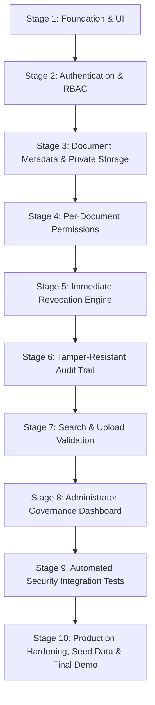

# TrustVault 🔐

> **Enterprise-Grade Secure Document-Sharing Platform with Auditable, Zero-Leakage Access Control.**  
> Built for the Snovasys Fresher Challenge 2026. Fully implemented, hardened, and verified across all 10 planned stages.

[](https://trust-vault-9185.vercel.app/)
[]()
[]()
[]()
[]()

---

## 1. Quick Start for Evaluators

Welcome to the **TrustVault** evaluator evaluation portal. This section provides immediate access to the production deployment, pre-configured evaluation accounts, a quick evaluation sequence, and a feature checklist.

### A. Live Website

The production frontend application is deployed and verified at:

👉 **[https://trust-vault-9185.vercel.app/](https://trust-vault-9185.vercel.app/)**

- **Production Frontend**: [https://trust-vault-9185.vercel.app/](https://trust-vault-9185.vercel.app/) (Hosted on Vercel)
- **Production Backend API**: `https://trustvault-wkaj.onrender.com/api` (Hosted on Render with automated health checks)
- **CORS Allowed Origins**: Pre-configured in the backend to permit `https://trust-vault-9185.vercel.app` and local development hosts.

> [!NOTE]
> When testing locally, use `http://localhost:5173` for the frontend and `http://localhost:5000` for the backend. The production URLs above are dedicated to cloud evaluation.

---

### B. Evaluation Accounts

The platform has been provisioned with four distinct evaluation accounts representing all platform personas. These credentials are confirmed in the database seed configuration (`backend/scripts/seed.js`) and directly accessible via the **Quick Demo Accounts** buttons on the login portal:

| Name | Login ID / Email | Demo Password | Role | Evaluation Purpose |
| :--- | :--- | :--- | :---: | :--- |
| **Marcus Vance** | `admin@trustvault.internal` | `TrustVault2026!` | `admin` | **Chief Security Officer (Administrator)** — Access to the Admin Governance Dashboard, Owner Approval Queue, User Directory, Role Assignment, Temporary Password Resets, and Global Immutable Audit Log Explorer with un-truncated CSV/JSON export. |
| **Sarah Jenkins** | `sarah.lead@trustvault.internal` | `TrustVault2026!` | `owner` | **VP of Engineering (Document Owner)** — Uploads confidential documents, selects visibility (`Private`, `Specific Users`, `All Registered Users`), assigns fine-grained Read/Edit ACL permissions, and revokes access instantly. |
| **Alex Mercer** | `alex.dev@trustvault.internal` | `TrustVault2026!` | `viewer` | **Platform Engineer (Viewer)** — Standard read-only collaborator. Views and downloads documents explicitly shared with him; edits metadata if granted Edit permissions; strictly blocked from uploading new documents. |
| **Jordan Lee** | `jordan.req@trustvault.internal` | `TrustVault2026!` | `viewer` *(pending owner request)* | **Pending Document Owner Requester** — Demonstrates the Owner approval workflow. Retains standard Viewer privileges while an active Owner request is queued for Administrator review in the Governance Dashboard. |

> [!IMPORTANT]
> **Jordan Lee's Account Workflow**: Jordan's account is intentionally seeded with `role: 'viewer'` and `ownerApprovalStatus: 'pending'` to demonstrate the approval workflow. While pending, Jordan sees a live status banner with submission details and a "Check Status" button. Once an Administrator approves the request in the Admin Dashboard, Jordan's effective role elevates to `owner` and upload privileges unlock immediately.

> [!WARNING]
> **Security Notice**: These demonstration credentials (`TrustVault2026!`) are provided exclusively for reviewer evaluation, local development, and automated testing. In production deployments with real confidential data, credentials must be generated with cryptographically strong randomness and stored in a secure secret manager.

---

### C. Quick Evaluation Steps

Follow this quick 8-step sequence to evaluate all core capabilities:

1. **Open the live website**: Navigate to [https://trust-vault-9185.vercel.app/](https://trust-vault-9185.vercel.app/).
2. **Sign in using an evaluation account**: On the login portal, click any of the **Quick Demo Accounts** buttons (e.g., **Document Owner** for Sarah Jenkins) and click **Sign In to Vault**.
3. **Explore the role-specific dashboard**: Observe the active workspace, stats cards, recent activity stream, and available navigation tabs for that role.
4. **Test document upload and visibility (Sarah - Owner)**:
   - Click **Upload Document**.
   - Notice the three visibility choices: `Private — Only Me` (default), `Share with Specific Users` (user directory selector with Read/Edit options), and `Share with All Registered Users`.
   - Select a document, enter title and tags, choose visibility, and click **Upload & Encrypt**.
5. **Test shared document access (Alex - Viewer)**:
   - Sign out Sarah and sign in as `alex.dev@trustvault.internal`.
   - In **Shared with Me**, locate the document shared by Sarah.
   - Click **Download** to receive the file with its original filename via the File System Access API.
   - If granted Edit permissions, click **Edit** to update tags and description through the Metadata Editor.
   - Note that Alex has no upload button, enforcing strict RBAC boundaries.
6. **Test owner approval, account governance, and audit trails (Marcus - Admin)**:
   - Sign in as `admin@trustvault.internal`.
   - Open **Admin Governance** from the sidebar.
   - In **Pending Document Owner Requests**, review Jordan Lee's pending request. Click **Approve** (elevates Jordan to Owner) or **Reject**.
   - Inspect the **Global Audit Trail**, apply action or actor filters, and click **Export CSV** or **Export JSON** to verify un-truncated compliance records.
   - Test user role modification with the **Zero Data Loss Guarantee** dialog.
7. **Examine the pending owner request workflow (Jordan - Pending Requester)**:
   - Sign in as `jordan.req@trustvault.internal`.
   - Inspect the pending status notice: *"Owner access request pending administrator approval — Under Review"*.
   - Click **Check Status** to test live profile synchronization against the backend.
8. **Test access revocation and zero-leakage isolation**:
   - Sign in as Sarah (Owner), open the document sharing modal, and click **Revoke** on Alex's permission grant.
   - Switch Alex back to the platform: access is revoked immediately with zero cache delay (`403 Forbidden`).
   - Switch visibility of a shared document back to `Private`: all prior collaborator ACLs are purged instantly.

---

### D. Quick Evaluation Checklist

- [x] **Distinct Sign In and Create Account Forms**: Completely separated interfaces with dedicated field schemas, clean state resets, component key isolation, and direct URL routing (`?mode=login` / `?mode=register`).
- [x] **Role-Based Access Control (RBAC)**: Strictly enforced roles (`admin`, `owner`, `viewer`) with server-side authorization middleware on all routes.
- [x] **Administrator, Owner, and Viewer Workflows**: Comprehensive role-tailored dashboards and capabilities verified on client and server.
- [x] **Document Upload, Preview, and Download**: Non-web-root private disk quarantine, UUID filename obfuscation, and native Save-As dialog preserving original filenames via File System Access API.
- [x] **Three-Tier Visibility Controls**: `Private — Only Me` (default), `Share with Specific Users` (granular Read/Edit ACLs), and `Share with All Registered Users` (authenticated accounts only).
- [x] **Read/Edit Permissions & Immediate Revocation**: Per-document collaborator permissions with zero-cache-lag direct-to-database revocation.
- [x] **Owner Approval & Notification Handling**: Viewer self-service escalation, Admin Notification Center, live badge counts, and Zero Data Loss Guarantee on role downgrade.
- [x] **Email Verification & Dual-Option Password Recovery**: 24-hour cryptographic verification tokens, Admin-assisted temporary resets (`Password@123` with mandatory change policy), and 15-minute self-service email reset links.
- [x] **Append-Only Immutable Audit Trail**: Pre-save database hooks rejecting PUT/PATCH/DELETE mutations; global audit log explorer with un-truncated CSV/JSON export.
- [x] **Scoped Search & Zero Metadata Leakage**: Database query pipeline filtering enforcing user ACLs; unauthorized keyword searches return 0 matching results.
- [x] **Responsive Mobile Layout & Robust Document Selection**: Centered upload dropzone with sufficient height (155px desktop / 140px mobile), fully visible cloud icon, touch-gesture overlay, debounced double-tap protection, and reliable Android document file selection path.
- [x] **Defensive Security Architecture**: Magic number file signature validation with auto-purge, bcrypt (12 salt rounds), rate limiting, and all 30 threat mitigations cataloged in `THREATS.md` verified.

---

## 2. Project Overview

**TrustVault** is an enterprise-grade document security and collaboration platform designed for organizations handling high-stakes confidential files—such as financial audits, legal contracts, board presentations, and intellectual property.

TrustVault enforces a strict **Zero-Trust** security architecture:
1. **Private Storage Isolation**: File binaries are never exposed in static web directories. All downloads are served through authenticated streaming controllers (`res.sendFile` / streaming pipeline) with `Content-Disposition: attachment` and `X-Content-Type-Options: nosniff`.
2. **Per-Document ACLs & Document Visibility**: Document owners can select document visibility during upload (`Private — Only Me`, `Share with Specific Users`, or `Share with All Registered Users`) and assign fine-grained `read` or `edit` permissions.
3. **Immediate Access Revocation Engine**: Permissions are checked directly against the database on every read or stream request with zero cache lag. Switching visibility to `private` immediately revokes all third-party access and clears prior ACL grants.
4. **Append-Only Immutable Audit Trail**: Every file upload, download, metadata read, permission grant, revocation, visibility change, and password lifecycle event is permanently recorded in a tamper-resistant ledger protected by schema pre-hooks.
5. **Upload & Magic-Number Validation**: Uploads are strictly checked against file signatures (magic numbers) to prevent disguised scripts/executables, with automatic disk purging.
6. **Administrator Governance Dashboard**: Real-time system analytics, global audit log explorer with un-truncated CSV/JSON export, user account deactivation, and single-use password recovery initiation.
7. **Secure Download with Original Filename**: Downloads use the browser's File System Access API (`showSaveFilePicker`) to present the original filename (e.g. `Report.pdf`) in a native Save-As dialog, bypassing Chromium's blob-URL UUID fallback. Bearer-token authentication is preserved; tokens are never placed in URLs.
8. **End-to-End Sharing & Metadata Editing**: Document owners can grant `read` or `edit` permissions. Recipients with Edit permission can modify document titles, descriptions, and discoverability tags through an integrated Metadata Editor modal, with changes reflected in real-time and audited in the immutable log. View recipients remain strictly restricted to read/download access.
9. **Zero-Trust Password Management**: Self-service change password with current password verification and 12-round bcrypt hashing, plus Admin-initiated single-use token recovery without credential leakage.
10. **Distinct Authentication Architecture & URL Routing**: Complete decoupling of Sign In and Create Account screens. The modal dialog (`AuthModals`) and full-screen portal (`AuthLandingPortal`) synchronize state dynamically via `initialMode` and `onModeChange` hooks, clearing stale passwords and errors on transition. Supports direct URL routing (`?mode=register` / `?mode=login`) and browser navigation.
11. **Mobile Ingestion & Resilient Streaming**: Dropzone with transparent touch gesture overlay preventing mobile WebView/iOS Safari synthetic click blocking, automatic client-side MIME-to-extension deduction for camera/photo pickers to avoid 415 rejections, double-tap debounce locks, and a 60-second blob URL retention window supporting mobile OS download managers.

---

## 3. Key Features

```
┌─────────────────────────────────────────────────────────────────────────────┐
│                          TrustVault Security Core                           │
├─────────────────────┬───────────────────────────┬───────────────────────────┤
│    Identity & RBAC  │   Document Management     │   Governance & Compliance │
│ • Admin / Owner /   │ • 3-Tier Visibility       │ • Append-Only Audit Trail │
│   Viewer Roles      │ • Granular Read/Edit ACLs │ • Un-truncated CSV / JSON │
│ • Owner Approval    │ • Magic Number Validation │ • Account Suspension      │
│ • Dual-Option Reset │ • Private Disk Isolation  │ • Zero Data Loss on       │
│ • Distinct Auth UI  │ • Native Save-As Filename │   Role Downgrade          │
└─────────────────────┴───────────────────────────┴───────────────────────────┘
```

- **Enterprise Role-Based Access Control (RBAC)**: Clear division of authority between Administrators (governance, approvals, audits), Document Owners (file upload, sharing, ACL management), and Viewers (read/download shared files).
- **Three-Tier Document Visibility**:
  - `Private — Only Me`: Strictly accessible to the uploader and administrative governance.
  - `Share with Specific Users`: Collaborator selector with granular `Read` or `Can Edit` permission levels.
  - `Share with All Registered Users`: Discoverable by all authenticated, active accounts; unauthenticated requests return `401 Unauthorized`.
- **Immediate Zero-Lag Access Revocation**: Direct database authorization check on every metadata read and binary stream request. Modifying document visibility to Private immediately revokes third-party access and purges collaborator grants.
- **File Signature & Magic Number Inspection**: Multi-byte binary signature verification rejecting executable files (`.exe`, `.bat`, `.sh`, `.bin`, `.msi`) disguised with document extensions (e.g., an ELF binary or shell script renamed as `.docx` or `.png`). Rejected uploads are purged from disk immediately.
- **Native Save-As Filename Preservation**: Solves Chromium's standard download limitation where blob URLs trigger generic UUID filenames (`d290f1ee-6c54-4b01...`). Uses the browser File System Access API (`showSaveFilePicker`) to populate the user's native file dialog with the sanitized original filename (e.g. `Quarterly_Report.pdf`), with automatic 60-second blob URL fallback for Firefox and Safari.
- **Admin Governance & Live Metrics**: System metrics (active users, total files, active grants, pending requests), user directory management, and one-click Owner request approval/rejection.
- **Tamper-Resistant Audit Trail**: Append-only MongoDB/in-memory collection with Mongoose schema hooks rejecting all `updateOne`, `updateMany`, `findOneAndUpdate`, `deleteOne`, and `deleteMany` operations.
- **Dual-Option Password Recovery Architecture**:
  - Option A: Admin-Assisted Reset (`POST /api/auth/forgot-password`) queuing an unread notification for Administrator review, resetting to `Password@123` with a mandatory `mustChangePassword` forced change policy.
  - Option B: Self-Service Email Reset Link (`POST /api/auth/forgot-password-email`) dispatching a 15-minute single-use cryptographic token directly to the user's verified inbox.
- **Transactional Email Integration**: Unified multi-provider engine supporting Brevo HTTPS REST API (Port 443, Render compatible), Resend REST API, and Gmail SMTP with App Passwords. Enforces duplicate transmission prevention and zero credential logging.
- **Responsive Mobile Layout & Touch Ingestion**: Dropzone with minimum 155px desktop / 140px mobile height, centered cloud upload icon, mobile touch gesture overlay, double-tap debouncing, and a comprehensive Android file selection path supporting documents (`.pdf, .docx, .xlsx, .pptx, .zip, .txt, .csv, .json, .md, .log`) and images without restrictive `image/*` picker locking.
- **Enterprise Theme Customization**: Real-time Light, Dark, and System Default appearance modes with OS `prefers-color-scheme` synchronization and localStorage persistence.

---

## 4. Technology Stack and Architecture

### Technology Stack

- **Backend API**: Node.js, Express 4, Mongoose with dual-engine architecture:
  - Persistent MongoDB Atlas connection when `MONGODB_URI` is provided.
  - Resilient zero-configuration in-memory repository fallback for instant local testing and offline execution.
- **Security & Cryptography**: bcryptjs (12 salt rounds), jsonwebtoken (HMAC SHA-256), crypto (SHA-256 token hashing, UUIDv4), defensive HTTP headers, sliding-window rate limiters.
- **File Ingestion & Storage**: Multer, private storage quarantine outside public web roots, magic-number binary inspection, mobile touch overlay.
- **File Download & Streaming**: File System Access API (`showSaveFilePicker`) for native Save-As with original filename; resilient 60-second blob-URL fallback for Firefox/Safari and mobile OS download managers.
- **Frontend SPA**: React 18, Vite 6, Lucide Icons, Pure CSS Design System Tokens (Linear / Stripe aesthetic, Light/Dark/System theme switcher with OS synchronization).
- **Testing**: Vitest 5, Supertest (18 test suites, 277 automated integration tests, 100% pass rate).

### 10-Stage Technical Roadmap



| Stage | Name | Status | Key Deliverables & Verified Achievements |
| :---: | :--- | :---: | :--- |
| **Stage 1** | **Foundation & Premium UI** | ✅ Complete | Express decoupled app factory, React + Vite SaaS shell, design system tokens, responsive navbar. |
| **Stage 2** | **Authentication & RBAC** | ✅ Complete | JWT issuance, bcrypt (12 rounds), RBAC middleware (`admin`, `owner` / Document Owner, `viewer` / Viewer). |
| **Stage 3** | **Metadata & Private Storage** | ✅ Complete | UUID disk filenames, non-web storage quarantine, secure binary streaming with original filename preservation. |
| **Stage 4** | **Per-Document Permissions** | ✅ Complete | Granular ACLs (`read` / `edit`), access delegation, ownership isolation, recipient collaborator directory. |
| **Stage 5** | **Immediate Revocation Engine** | ✅ Complete | Zero token caching lag, direct-to-database download authorization, instant grant clearing on visibility shift to Private. |
| **Stage 6** | **Tamper-Resistant Audit Trail** | ✅ Complete | Append-only ledger, schema pre-hooks rejecting PUT/PATCH/DELETE mutations, un-truncated CSV/JSON export. |
| **Stage 7** | **Search & Upload Validation** | ✅ Complete | Scoped search without metadata leaks, magic number header inspection, automatic disk purging of rejected uploads. |
| **Stage 8** | **Admin Governance Dashboard** | ✅ Complete | System analytics, Owner request moderation queue, un-truncated CSV/JSON audit export, user account deactivation. |
| **Stage 9** | **Automated Security Integration** | ✅ Complete | 100% automated verification of all 30 threat vectors cataloged in `THREATS.md`. |
| **Stage 10** | **Production Hardening & Verification** | ✅ Complete | Three-tier visibility cards, self-service & admin password recovery, distinct auth forms, Brevo HTTPS email delivery, mobile touch dropzone, 0 audit vulnerabilities. |

---

## 5. Installation and Local Setup

### Prerequisites

- **Node.js**: `v18.x` or higher (`v22+` recommended)
- **npm**: `v9.x` or higher
- **Git**: For repository cloning

### Clean-Clone Setup Instructions

1. **Clone the repository**:
   ```bash
   git clone https://github.com/Abhi-4363/TrustVault.git
   cd TrustVault
   ```

2. **Configure Environment Variables**:
   Copy the example environment templates:
   ```bash
   # Backend environment configuration
   cp backend/.env.example backend/.env

   # Frontend environment configuration (optional for local dev)
   cp frontend/.env.example frontend/.env
   ```
   *The default values in `backend/.env.example` work out of the box for local development. If MongoDB is not running locally, TrustVault automatically uses its in-memory repository fallback.*

3. **Install Dependencies & Seed Database**:
   ```bash
   # Install and seed backend
   cd backend
   npm install
   npm run seed     # Seeds Marcus (Admin), Sarah (Owner), Alex (Viewer), Jordan (Pending Owner)

   # Install frontend
   cd ../frontend
   npm install
   ```

4. **Start Development Servers**:
   Open two terminal windows:

   **Terminal 1 — Backend API Server (Port 5000):**
   ```bash
   cd backend
   npm run dev      # Starts Express API at http://localhost:5000 with auto-reload
   ```

   **Terminal 2 — Frontend Client (Port 5173):**
   ```bash
   cd frontend
   npm run dev      # Starts Vite dev server at http://localhost:5173
   ```

5. **Open Application**:
   Navigate to `http://localhost:5173` in your browser.

---

## 6. Environment Variables and Email Configuration

### Local Development Configuration (`backend/.env`)

For local execution, the environment configuration defaults to local ports:

```env
# Network Port & Environment
PORT=5000
NODE_ENV=development

# Allowed Frontend Origin for CORS Policies
CLIENT_URL=http://localhost:5173

# Frontend Base URL for Generating Verification & Reset Links
APP_BASE_URL=http://localhost:5173

# Database Connection (MongoDB Atlas or Local MongoDB)
# Falls back to zero-config in-memory store if offline
MONGODB_URI=mongodb://localhost:27017/trustvault_dev

# JWT Authentication Secret & Lifetime
JWT_SECRET=trustvault_dev_secret_change_in_production_min32chars
JWT_EXPIRES_IN=24h

# Transactional Email Provider Selection: 'brevo' | 'resend' | 'smtp'
EMAIL_PROVIDER=brevo
EMAIL_FROM=konagallaabhiram@gmail.com

# Brevo HTTPS REST API (Port 443 - Recommended)
BREVO_API_KEY=your_brevo_v3_api_key_here

# Resend HTTPS REST API (Alternative)
RESEND_API_KEY=your_resend_api_key_here

# Gmail SMTP Configuration (Alternative for local dev)
SMTP_HOST=smtp.gmail.com
SMTP_PORT=587
SMTP_SECURE=false
SMTP_USER=trustvaultOff@gmail.com
SMTP_PASS=your_google_app_password_here
```

### Production Cloud Configuration (Vercel + Render)

In production, keep the frontend and backend URLs separate:

- **Frontend Origin & App Base URL**: `https://trust-vault-9185.vercel.app/`
- **Backend API Base URL**: `https://trustvault-wkaj.onrender.com/api`

```env
# Production Backend Environment Variables (configured in Render Dashboard)
PORT=5000
NODE_ENV=production

# Frontend Origin for CORS & Verification/Reset Link Generation
CLIENT_URL=https://trust-vault-9185.vercel.app/
APP_BASE_URL=https://trust-vault-9185.vercel.app/

# Persistent Database & Storage
MONGODB_URI=mongodb+srv://<db_user>:<db_password>@cluster.mongodb.net/trustvault_prod?retryWrites=true&w=majority
STORAGE_DIR=/opt/render/project/src/backend/storage/uploads

# Cryptographic Secrets
JWT_SECRET=your_production_random_32char_jwt_secret
JWT_EXPIRES_IN=24h

# Transactional Email Service via Brevo HTTPS REST API (Render Compatible)
EMAIL_PROVIDER=brevo
EMAIL_FROM=konagallaabhiram@gmail.com
BREVO_API_KEY=xkeysib-your-production-brevo-api-key
```

```env
# Production Frontend Environment Variables (configured in Vercel Dashboard)
VITE_API_BASE_URL=https://trustvault-wkaj.onrender.com/api
VITE_APP_ENV=production
```

### Transactional Email Subsystem & Multi-Provider Architecture

TrustVault incorporates a unified transactional email engine designed for resilient delivery across both local development and cloud hosting platforms:

1. **Brevo HTTPS REST API (Recommended for Cloud / Render)**:
   - **Provider Setting**: `EMAIL_PROVIDER=brevo`
   - **Transport**: HTTPS POST to `https://api.brevo.com/v3/smtp/email` over Port 443.
   - **Authentication**: `api-key` header with `BREVO_API_KEY`.
   - **Cloud Advantage**: Guaranteed delivery on platforms like Render where raw outbound SMTP ports (25, 465, 587) are restricted on free/starter tiers.
   - **Mandatory Sender Verification**: The sender address (`EMAIL_FROM`) must be verified in your Brevo dashboard under **Senders & IP -> Senders**.
2. **Resend HTTPS REST API**:
   - **Provider Setting**: `EMAIL_PROVIDER=resend`
   - **Transport**: HTTPS POST to `https://api.resend.com/emails` with Bearer token authentication over Port 443.
   - **Credentials**: `RESEND_API_KEY`.
3. **Nodemailer SMTP (Gmail / Custom SMTP Relay)**:
   - **Provider Setting**: `EMAIL_PROVIDER=smtp`
   - **Transport**: Direct TCP connection to `smtp.gmail.com` on Port 587 (STARTTLS) or 465 (SSL).
   - **Credentials**: `SMTP_HOST`, `SMTP_PORT`, `SMTP_USER`, `SMTP_PASS` (16-character Google App Password).
4. **Single-Provider Dispatch & Duplicate Prevention**: The service resolves the single active provider prior to transmission. Each email is routed exclusively through that provider. If the active provider rejects the payload, an error is recorded without falling through to secondary providers to prevent duplicate email delivery.
5. **Zero Secret Leakage Invariant**: Logs and audit records document delivery status, recipient email, and timestamps, but strictly omit passwords, API keys, raw verification tokens, or reset tokens.

---

## 7. Evaluation Accounts and Role Workflows

The TrustVault RBAC model implements three primary roles with strict separation between effective privileges and requested permissions:

```
┌─────────────────────────────────────────────────────────────────────────────┐
│                            TrustVault RBAC Model                            │
├────────────────────┬────────────────────────────────────────────────────────┤
│ Role               │ Authorized Capabilities                                │
├────────────────────┼────────────────────────────────────────────────────────┤
│ Administrator      │ • Full platform governance & metrics dashboard         │
│ (Marcus Vance)     │ • Review, approve, or reject Owner access requests     │
│                    │ • View & export un-truncated CSV/JSON audit trails     │
│                    │ • Promote / downgrade user roles (Zero Data Loss)      │
│                    │ • Deactivate / activate user accounts                  │
│                    │ • Initiate Admin-assisted single-use password resets   │
├────────────────────┼────────────────────────────────────────────────────────┤
│ Document Owner     │ • Upload confidential documents to private storage     │
│ (Sarah Jenkins)    │ • Select 3-tier visibility (Private, Specific, All)    │
│                    │ • Assign Read or Can Edit permissions to named peers   │
│                    │ • Revoke collaborator access instantly (zero lag)      │
│                    │ • Update metadata (title, tags, description)           │
│                    │ • View personal document audit trail                   │
├────────────────────┼────────────────────────────────────────────────────────┤
│ Viewer             │ • View and download documents explicitly shared        │
│ (Alex Mercer)      │ • Discover platform-wide (All Registered Users) docs   │
│                    │ • Edit metadata if explicitly granted 'Can Edit'       │
│                    │ • Request Document Owner privileges via dashboard      │
│                    │ • Strictly blocked from uploading or deleting files    │
├────────────────────┼────────────────────────────────────────────────────────┤
│ Pending Owner      │ • Same operational capabilities as Viewer              │
│ (Jordan Lee)       │ • Active Owner request queued for Admin approval       │
│                    │ • Live status notice with 'Check Status' polling       │
└────────────────────┴────────────────────────────────────────────────────────┘
```

### Strict Separation of Effective vs. Requested Role

TrustVault distinguishes an account's **effective role** (`role`: `admin`, `owner`, `viewer`) from its **requested role** (`requestedRole`: `owner`, `viewer`, or `null`) and approval lifecycle (`ownerApprovalStatus`: `not_required`, `pending`, `approved`, `rejected`):

1. **Public Registration Policy**: Public registrations always provision accounts as **effective Viewers (`role: 'viewer'`)**. Users requesting `owner` privileges have their account flagged as `ownerApprovalStatus: 'pending'` and are queued for Administrator review.
2. **In-App Notice & Real-Time Status**: Pending requester accounts see an informative status banner showing submission date and retain full Viewer privileges to documents shared with them. A live "Check Status" button polls `/api/auth/me` to refresh approval state.
3. **Approved Accounts Clean State**: When an account is approved (`role === 'owner'` or `ownerApprovalStatus === 'approved'`), any pending request banners are automatically cleared, ensuring approved owners never see stale pending notices.
4. **Admin Moderation Actions**:
   - `POST /api/admin/owner-requests/:userId/approve`: Elevates effective role to `owner`, sets status to `approved`, and emits an immutable `OWNER_REQUEST_APPROVED` audit log. Upload privileges activate immediately.
   - `POST /api/admin/owner-requests/:userId/reject`: Retains effective role as `viewer`, records rejection reason, sets status to `rejected`, and emits `OWNER_REQUEST_REJECTED`.
5. **Zero Data Loss Guarantee on Role Downgrade**:
   - When an Administrator downgrades an Owner to Viewer (`USER_DOWNGRADED_TO_VIEWER`), upload and sharing capabilities are revoked immediately.
   - **All documents previously uploaded by the downgraded user remain strictly preserved in private vault storage**. No files are deleted or reassigned, and existing collaborator access remains fully functional.
   - A confirmation modal explicitly outlines this guarantee before changes take effect.

---

## 8. Document Visibility and Permission Management

When an Owner uploads a document, TrustVault presents the **"Who can access this document?"** selector:

```
┌─────────────────────────────────────────────────────────────────────────────┐
│                       Document Visibility Architecture                      │
├────────────────────────────────┬────────────────────────────────────────────┤
│ 1. Private — Only Me (Default) │ • Only the document owner (and admin       │
│                                │   compliance governance) can view/stream.  │
│                                │ • 100% hidden from search and other users. │
├────────────────────────────────┼────────────────────────────────────────────┤
│ 2. Share with Specific Users   │ • Collaborator directory selector.         │
│                                │ • Assign per-user 'Read' or 'Can Edit'.    │
│                                │ • Appears in recipient's "Shared with Me". │
├────────────────────────────────┼────────────────────────────────────────────┤
│ 3. Share with All Registered   │ • Accessible to all authenticated users.   │
│    Users                       │ • Unauthenticated internet traffic is      │
│                                │   strictly blocked with 401 Unauthorized.  │
│                                │ • Default permission is Read-Only.         │
└────────────────────────────────┴────────────────────────────────────────────┘
```

### Dynamic Visibility Modification & Zero-Lag Immediate Revocation

- **Real-Time Visibility Updates**: Document owners can update document visibility at any time (`PATCH /api/documents/:id/visibility`).
- **Immediate Revocation**: Switching visibility from `all_authenticated_users` or `selected_users` to `private` **immediately revokes all collaborator access and clears prior ACL grants**. Subsequent protected requests fail immediately with `403 Forbidden`.
- **Metadata Editing Permission**: Recipients granted `edit` permissions can modify document titles, descriptions, and discoverability tags through an integrated Metadata Editor modal. View-only recipients remain restricted to read/download access.
- **Audit Logging**: Every visibility modification emits an immutable audit event (`DOCUMENT_VISIBILITY_UPDATED`).

---

## 9. Authentication, Profile, and Password Recovery

### Distinct Sign In and Create Account Architecture

TrustVault strictly decouples the Sign In and Create Account interfaces to prevent input cross-contamination or ambiguous modal rendering:

- **Dedicated Field Schemas**:
  - **Sign In**: Displays Work Email, Password (with toggle), inline "Forgot Password?" trigger, "Verify email / Resend?" link, "Sign In to Vault" submission, and quick-access verified Demo Role selection cards. All registration-specific inputs (Full Name, Date of Birth, Confirm Password, Role selection, Terms & Privacy checkbox) are completely absent.
  - **Create Account**: Displays Full Name, Work Email, Date of Birth (minimum age 13 enforcement), Password, Confirm Password, Requested Account Role (`Viewer` or `Document Owner`), Terms & Privacy acceptance checkbox, and "Create Account" submission. Login-only controls and demo role cards are strictly excluded.
- **State Synchronization & Component Keys**:
  - The authentication dialog (`AuthModals.jsx`) and landing portal (`AuthLandingPortal.jsx`) maintain dynamic synchronization with parent state via `initialMode` and `onModeChange` callbacks.
  - Component instances utilize distinct React keys (`key={`${authModalMode}-${authModalOpen}`}`), ensuring state re-initialization and preventing retention of stale passwords, confirmation values, or validation errors when switching modes.
- **Direct Query Parameter & Hash Routing**: Deep-linkable via URL query parameters (`?mode=register` or `?mode=login`) and URL hashes (`#register` or `#login`). Browser navigation events (`popstate`, `hashchange`) dynamically update the active form mode without requiring full page reloads.

### Date of Birth Policy & Minimum Age Enforcement

- **Minimum Age Rule**: Enforces a strict minimum age requirement (defaulting to **13 years old**).
- **Exact Calendar Calculation**: Calculates age by evaluating exact birth year, month, and day rather than merely subtracting birth year from current year.
- **Calendar Validation**: Rejects malformed dates (e.g., February 30th), leap year anomalies, and future dates on client and server.
- **Timezone Drift Defense**: Persisted as a date-only string in `YYYY-MM-DD` format (ISO 8601 calendar date), preventing UTC timezone shifts from altering displayed birthdays.
- **Privacy Enforcement**: Date of birth is excluded from audit ledgers to protect sensitive PII.

### Terms & Conditions and Privacy Policy Versioning

- **Version Constants**: `CURRENT_TERMS_VERSION = '1.0.0'`, `CURRENT_PRIVACY_VERSION = '1.0.0'`, `TERMS_POLICY_EFFECTIVE_DATE = '2026-10-22'`.
- **Auditable Server Timestamp**: The user record captures `termsVersionAccepted`, `privacyVersionAcknowledged`, `termsPolicyEffectiveDate`, and a strictly server-generated timestamp `termsAcceptedAt`.
- **Accessible Legal Modals**: Dedicated accessible modal dialogs with keyboard navigation, `Escape` key dismissal, focus trapping, and scrollable responsive viewports.

### Editable Profile & Immediate Name Synchronization

- **Self-Service Editing**: Users can edit their display name and date of birth inline or in a dialog with Save/Cancel controls, frontend validation, server-side validation, and instant visual feedback.
- **Mass Assignment Protection**: Attempts to alter `role`, `isAdmin`, `isEmailVerified`, or permissions via `PUT /api/auth/profile` are strictly rejected or stripped.
- **Cross-Collection Name Propagation**: When a user updates their name, the backend atomically updates the primary user identity record (`User.name`), owned document records (`Document.ownerName`), collaborator entries in permission lists (`Document.acl[].name`), pending Admin notifications (`AdminNotification.userName`), active password reset requests (`PasswordResetRequest.userName`), and records an immutable `PROFILE_UPDATED` audit log.

### Dual-Option Password Recovery Architecture

TrustVault provides two distinct, clearly separated password recovery options:

| Recovery Feature | Option A: Administrator-Assisted Recovery | Option B: Self-Service Email Reset Link |
| :--- | :--- | :--- |
| **Trigger Mechanism** | User clicks "Request Reset from Admin" | User clicks "Send Password Reset Link" |
| **Backend Endpoint** | `POST /api/auth/forgot-password` | `POST /api/auth/forgot-password-email` |
| **Admin Intervention** | **Required** (Admin reviews in Notification Center) | **None** (Fully automated via email) |
| **Resulting Credential** | Temporary evaluation password: `Password@123` | User sets their own permanent password |
| **Enforced Policy** | `mustChangePassword: true` forces password change on next login | Password replaces existing credentials immediately |
| **Token Lifetime** | Admin review queue (until approved/rejected) | Cryptographic token expires in **15 minutes** |
| **Enumeration Defense** | Neutral response: *"If this email address is registered..."* | Neutral response: *"If an account exists with this email..."* |
| **Notification Sync** | Creates persistent `PasswordResetRequest` + `AdminNotification` | Direct email delivery; no Admin notification clutter |

#### Mandatory Temporary-Password Policy (`Password@123`)

When an Administrator clicks **Reset Password** on a pending notification:
1. The user's password is reset to **`Password@123`**, securely hashed with bcrypt (12 rounds).
2. The user account is flagged with `mustChangePassword: true`.
3. On the user's next login with `Password@123`, the backend blocks all protected endpoints with `403 PASSWORD_CHANGE_REQUIRED`.
4. The frontend renders `ForcedPasswordChangeModal`, preventing any navigation or document access until a new password satisfying complexity rules is configured.

---

## 10. Security Threat Model

All 30 security attack vectors cataloged in [`THREATS.md`](./THREATS.md) have been systematically mitigated and verified via automated integration tests:

| Threat ID | Threat Vector | Mitigation Strategy | Test Suite Result |
| :---: | :--- | :--- | :---: |
| **THREAT-01** | Unauthorised Document Access | Server-side authorization check before fetching bytes or metadata | **VERIFIED (403 Forbidden)** |
| **THREAT-02** | IDOR & ID Guessing | Strict `{ _id, ...authorisationFilter }` queries without existence leakage | **VERIFIED (404 Not Found)** |
| **THREAT-03** | Permission Revocation Lag | Direct-to-database permission check on every stream with zero cache lag | **VERIFIED (Zero Delay)** |
| **THREAT-04** | Publicly Accessible File URLs | Storage isolated outside web root; direct static GET probes return 404 | **VERIFIED (404 Not Found)** |
| **THREAT-05** | Audit Log Tampering | Pre-save schema hooks reject PUT, PATCH, and DELETE operations | **VERIFIED (Append-Only)** |
| **THREAT-06** | Privilege Escalation | Registration role parameter forced to `'viewer'`; owner requests queued | **VERIFIED (403 Forbidden)** |
| **THREAT-07** | Malicious / Disguised Uploads | Magic number signature verification; automatic disk purging of rejects | **VERIFIED (415 Unsupported)** |
| **THREAT-08** | Cross-Site Scripting (XSS) | Backend HTML and event-handler stripping in document metadata | **VERIFIED (Sanitized)** |
| **THREAT-09** | CSRF & Missing Bearer Token | Stateless Bearer token verification; requests without headers rejected | **VERIFIED (401 Unauthorized)** |
| **THREAT-10** | Session & Token Tampering | HMAC SHA-256 JWT validation; expired or altered tokens rejected | **VERIFIED (401 Unauthorized)** |
| **THREAT-11** | Search Metadata Leakage | Search queries enforce ACL filters inside database query pipeline | **VERIFIED (0 Results Leaked)** |
| **THREAT-12** | Concurrency Race Conditions | Atomic database operations (`$set`, `$pull`) and pre-stream validation | **VERIFIED (Race-Free)** |
| **THREAT-13** | Owner Self-Promotion | Registration defaults to Viewer; Owner requests strictly queued | **VERIFIED (403 Forbidden)** |
| **THREAT-14** | Data Loss on Downgrade | Documents strictly preserved on Owner downgrade without deletion | **VERIFIED (Zero Loss)** |
| **THREAT-15** | Accidental Oversharing | Default Private visibility; instant revocation on switch to Private | **VERIFIED (Zero Lag)** |
| **THREAT-16** | Reset Token Replay | Single-use SHA-256 token hashing; 1-hour expiration; audit sanitization | **VERIFIED (Single-Use)** |
| **THREAT-17** | Password Reset Abuse & Flooding | Timing-safe neutral responses; request deduplication; rate limiting | **VERIFIED (Deduplicated)** |
| **THREAT-18** | Notification Center Spoofing | Administrative endpoints strictly protected by `requireRole('admin')` | **VERIFIED (403 Forbidden)** |
| **THREAT-19** | Permanent Temporary Password | Mandatory `mustChangePassword: true` blocking vault until changed | **VERIFIED (Enforced)** |
| **THREAT-20** | Unverified Account Vault Access | Unverified accounts blocked from document routes with `403` | **VERIFIED (403 Forbidden)** |
| **THREAT-21** | Verification Token Replay | 32-byte SHA-256 tokens; atomic consumption; 24-hour expiration | **VERIFIED (Single-Use)** |
| **THREAT-22** | Reset Token Interception | Short 15-minute expiration; complexity enforcement; session invalidation | **VERIFIED (15m Expiry)** |
| **THREAT-23** | User Enumeration via Probes | Identical neutral responses for registered vs non-existent emails | **VERIFIED (Zero Leakage)** |
| **THREAT-24** | Email Provider Failures & Leaks | Credentials stored in `.env`; safe diagnostics; zero secret logging | **VERIFIED (Sanitized Logs)** |
| **THREAT-25** | Underage Registration & DOB Bypass | Server-side ISO calendar validation; exact 13-year age calculation | **VERIFIED (Boundary Checked)** |
| **THREAT-26** | Terms Non-Acceptance Spoofing | Server-bound policy versions; strictly server-generated timestamps | **VERIFIED (Server Timestamp)** |
| **THREAT-27** | Profile Mass Assignment & XSS | Strict field whitelist (`name`, `dateOfBirth`); multi-model name sync | **VERIFIED (Whitelisted)** |
| **THREAT-28** | DOB Privacy Leakage in Audits | Date of birth excluded from audit event metadata to protect PII | **VERIFIED (PII Excluded)** |
| **THREAT-29** | Auth Form State Contamination | Dynamic mode synchronization; React key re-mounting; deep link routing | **VERIFIED (Clean State)** |
| **THREAT-30** | Mobile File Ingestion Sandboxing | Dropzone touch overlay; client MIME deduction; debounced submission | **VERIFIED (Mobile Ingestion)** |

---

## 11. Testing and Validation

TrustVault maintains a **100% test pass rate across all 18 test suites with 277 automated integration tests**:

```bash
cd backend
npm test
```

### Automated Test Coverage Breakdown

| Suite | File | Tests | Key Security Invariants Covered |
| :--- | :--- | :---: | :--- |
| **Brevo & Multi-Provider Delivery** | [`backend/tests/brevo-and-providers.test.js`](backend/tests/brevo-and-providers.test.js) | 18 | Brevo HTTPS REST API (`api-key` header, Port 443), explicit `EMAIL_PROVIDER` selection (`brevo`, `resend`, `smtp`), single-provider dispatch (duplicate prevention), messageId acceptance verification, unverified sender error handling. |
| **Email Verification & Password Reset** | [`backend/tests/email-and-verification.test.js`](backend/tests/email-and-verification.test.js) | 20 | Unverified user blocking (403), 24h verification link token lifecycle, anti-reuse, live Brevo registration dispatch, dual-option password recovery, 15m reset link. |
| **Admin Notifications & Reset** | [`backend/tests/admin-notifications-and-password-reset.test.js`](backend/tests/admin-notifications-and-password-reset.test.js) | 28 | Role-wide password change, forgot-password request anti-enumeration, Admin Notification Center, temporary Password@123 reset, mandatory password change policy. |
| **Visibility & Password Mgmt** | [`backend/tests/visibility-and-password-management.test.js`](backend/tests/visibility-and-password-management.test.js) | 12 | Default private, cross-user isolation, immediate revocation, self password change, admin password recovery, single-use token consumption. |
| **Visibility & Viewer Edge Cases** | [`backend/tests/visibility-and-viewer-bug.test.js`](backend/tests/visibility-and-viewer-bug.test.js) | 12 | Edge-case boundary tests for visibility inheritance, viewer isolation, unshared document concealment, and grant-level revocation. |
| **Admin Governance & Audit** | [`backend/tests/admin-governance.test.js`](backend/tests/admin-governance.test.js) | 32 | System analytics, un-truncated CSV/JSON export, user account deactivation, role updates. |
| **Security Threat Integration** | [`backend/tests/security-integration.test.js`](backend/tests/security-integration.test.js) | 18 | Automated verification of all cataloged threat vectors in `THREATS.md`. |
| **Upload Signature & Search** | [`backend/tests/search-validation.test.js`](backend/tests/search-validation.test.js) | 18 | Magic-number binary header inspection, scoped search isolation. |
| **Permissions & Delegation** | [`backend/tests/permissions.test.js`](backend/tests/permissions.test.js) | 17 | Per-document ACLs (`read`/`edit`), multi-user collaboration. |
| **Document Access & Streaming** | [`backend/tests/document.test.js`](backend/tests/document.test.js) | 16 | Private disk storage, UUID obfuscation, download authorization. |
| **Owner Approval Workflow** | [`backend/tests/owner-approval-workflow.test.js`](backend/tests/owner-approval-workflow.test.js) | 13 | Viewer-default registration, pending owner queue, approval/rejection lifecycle, downgrade with zero data loss, self-promotion blocking. |
| **Authentication & RBAC** | [`backend/tests/auth.test.js`](backend/tests/auth.test.js) | 13 | bcrypt (12 rounds), HMAC SHA-256 JWT, deactivated account blocking. |
| **Registration & Profile** | [`backend/tests/registration-and-profile.test.js`](backend/tests/registration-and-profile.test.js) | 18 | Complete registration input validation, profile retrieval, password requirements. |
| **Visibility Sharing Transitions** | [`backend/tests/visibility-sharing-transitions.test.js`](backend/tests/visibility-sharing-transitions.test.js) | 19 | Dynamic switching between Private, Specific Users, and All Users, ACL preservation and cleanup. |
| **Viewer Owner Request** | [`backend/tests/viewer-owner-request.test.js`](backend/tests/viewer-owner-request.test.js) | 11 | Viewer self-service role escalation request lifecycle and Admin moderation queue. |
| **Tamper-Resistant Audit** | [`backend/tests/audit.test.js`](backend/tests/audit.test.js) | 7 | Append-only ledger, mutation rejection, chronological ordering. |
| **Service Health Check** | [`backend/tests/health.test.js`](backend/tests/health.test.js) | 3 | Server uptime, environment state, storage accessibility. |
| **Immediate Access Revocation** | [`backend/tests/revocation.test.js`](backend/tests/revocation.test.js) | 2 | Zero token caching lag, direct-to-database check. |

### Frontend Production Build Verification

```bash
cd frontend
npm run build
```
*Result*: Vite 6 transforms modules and produces an optimized production bundle with **0 warnings and 0 errors**.

---

## 12. Deployment — Vercel Frontend and Render Backend

TrustVault is architected for seamless cloud production deployment:

### Production URLs

- **Production Frontend**: [https://trust-vault-9185.vercel.app/](https://trust-vault-9185.vercel.app/) (Vercel)
- **Production Backend**: `https://trustvault-wkaj.onrender.com/api` (Render)

### Render Infrastructure as Code (`render.yaml`)

The repository includes a verified `render.yaml` blueprint:

```yaml
services:
  - type: web
    name: trustvault-api
    env: node
    plan: starter
    region: oregon
    rootDir: backend
    buildCommand: npm install
    startCommand: node server.js
    healthCheckPath: /api/health
    disk:
      name: trustvault-storage
      mountPath: /opt/render/project/src/backend/storage/uploads
      sizeGB: 10
```

- **Persistent Disk Isolation**: The 10GB persistent disk mounted at `/opt/render/project/src/backend/storage/uploads` guarantees uploaded binaries persist across application restarts and redeployments.
- **Automated Health Checks**: Express exposes `GET /api/health` reporting server status, storage directory accessibility, and database connectivity.

---

## 13. Mobile and Responsive UI

TrustVault is fully optimized for touchscreens and mobile viewports down to narrow 360–390px screens:

- **Upload Modal Dropzone Height & Centering**: The upload dropzone provides a guaranteed minimum height of **155px on desktop** and **140px on mobile** (`flex-shrink: 0`, flex centering). The cloud upload icon (42px desktop / 38px mobile) and prompt text are fully visible, centered, and never clipped.
- **Smooth Modal Scrolling**: The upload modal container enforces `max-height: calc(100dvh - 12px)` with an auto-scrolling form container (`overscroll-behavior: contain`), ensuring all form controls and footer action buttons (Upload & Encrypt, Cancel) remain easily reachable on small mobile screens.
- **Reliable Android Document Selection Path**:
  - The standard file input specifies explicit document extensions (`.pdf, .docx, .xlsx, .pptx, .zip, .txt, .csv, .json, .md, .log, .png, .jpg, .jpeg, .gif`) and concrete MIME types without the wildcard `image/*`. On Android Chromium browsers, removing `image/*` prevents the camera/photos-only bottom sheet from trapping the user and opens the native Android system document picker.
  - A dedicated **"Browse Device Storage"** fallback button triggers an unrestricted file selector (`accept="*/*"`), giving Android users a direct path to the system file manager.
  - Automatic client-side MIME-to-extension deduction constructs a named `File` object for generic filenames (e.g. `image` or `blob`), preventing `415 UNSUPPORTED_MEDIA_TYPE` rejections.
- **Touch Gesture Overlay**: Replaced hidden file inputs (`display: none`) with an absolute transparent overlay (`.upload-dropzone-input`) spanning the entire dropzone, eliminating synthetic `.click()` blocking enforced by mobile WebView/iOS Safari gesture sandboxes.
- **Double-Tap Debouncing**: Synchronous submission locks (`if (loading) return;`) protect against duplicate multipart uploads triggered by rapid touchscreen taps.
- **Resilient Blob URL Lifetime**: Download blob object URLs are retained for 60 seconds before invocation of `URL.revokeObjectURL()`, allowing mobile OS download managers sufficient streaming time without premature stream termination.
- **Theme Selector Clamping**: Theme switcher dropdown menus enforce right-aligned viewport clamping (`right: 0`, `min-width: 230px`), preventing horizontal screen overflow on narrow mobile screens (< 375px).

---

## 14. Troubleshooting

| Symptom | Cause | Solution |
| :--- | :--- | :--- |
| **Brevo returns HTTP 400 Bad Request** | The sender address (`EMAIL_FROM`) is not verified in Brevo. | In the Brevo dashboard, go to **Senders & IP -> Senders** and verify the sender email address or domain. |
| **Gmail SMTP returns `535 5.7.8 BadCredentials`** | Using your standard Gmail password instead of a Google App Password. | Enable 2-Step Verification in Google Account Security, generate a 16-character App Password at [Google App Passwords](https://myaccount.google.com/apppasswords), and set `SMTP_PASS` without spaces. |
| **CORS error on API requests** | The requesting origin is not in the allowed origins set. | Ensure `CLIENT_URL` matches the frontend URL exactly (e.g. `http://localhost:5173` or `https://trust-vault-9185.vercel.app/`). |
| **MongoDB connection fails locally** | Local MongoDB daemon is not running. | TrustVault automatically falls back to its built-in in-memory repository with zero configuration required. To use MongoDB, start the service or provide a MongoDB Atlas URI. |
| **Android file picker opens only Photos/Videos** | The file input included `image/*` wildcard in the accept attribute. | Resolved in current version: explicit MIME types and extensions are used alongside a secondary "Browse Device Storage" button. |

---

## 15. Project Structure

```
TrustVault/
├── backend/
│   ├── scripts/
│   │   └── seed.js                         # Seeds Marcus (Admin), Sarah (Owner), Alex (Viewer), Jordan (Pending)
│   ├── src/
│   │   ├── app.js                          # Express decoupled application factory & CORS configuration
│   │   ├── config/
│   │   │   ├── database.js                 # Dual-engine database adapter (MongoDB Atlas + In-Memory)
│   │   │   └── env.js                      # Centralized environment variable parsing & defaults
│   │   ├── controllers/
│   │   │   ├── admin.controller.js         # Governance, analytics, audit export, owner approval, role updates
│   │   │   ├── auth.controller.js          # Authentication, registration, DOB age 13, profile sync, password reset
│   │   │   └── document.controller.js      # Upload, 3-tier visibility, ACL sharing, metadata editing, streaming
│   │   ├── middleware/
│   │   │   ├── auth.middleware.js          # JWT verification, RBAC role guard, email verification gate
│   │   │   ├── fileSignature.middleware.js # Magic number binary inspection & auto-disk-purge
│   │   │   ├── rateLimiter.middleware.js   # Sliding-window general and password-reset rate limiters
│   │   │   ├── security.middleware.js      # Defensive HTTP security headers
│   │   │   └── upload.middleware.js        # Multer private storage disk configuration (25MB limit)
│   │   ├── models/
│   │   │   ├── adminNotification.model.js  # Persistent notifications for owner requests & password resets
│   │   │   ├── audit.model.js              # Append-only immutable audit ledger with mutation pre-hooks
│   │   │   ├── document.model.js           # Document metadata, 3-tier visibility, ACLs, category
│   │   │   └── user.model.js               # User identity, roles, DOB, Terms versioning, 12-round bcrypt
│   │   ├── routes/
│   │   │   ├── admin.routes.js             # /api/admin endpoints (governance, notifications, export)
│   │   │   ├── auth.routes.js              # /api/auth endpoints (login, register, forgot-password, profile)
│   │   │   └── document.routes.js          # /api/documents endpoints (upload, share, visibility, stream)
│   │   ├── services/
│   │   │   ├── audit.service.js            # Immutable audit logging service with IP/actor tracking
│   │   │   ├── email.service.js            # Multi-provider email engine (Brevo, Resend, Nodemailer SMTP)
│   │   │   └── revocation.service.js       # Immediate zero-lag memory revocation tracker
│   │   └── utils/
│   │       └── token.js                    # Cryptographic token generator & JWT signer/verifier
│   ├── storage/
│   │   └── uploads/                        # Quarantined private storage directory (outside web root)
│   ├── tests/                              # 18 automated integration test suites (277 tests)
│   ├── server.js                           # Express entry point
│   └── package.json
├── frontend/
│   ├── src/
│   │   ├── components/
│   │   │   ├── admin/
│   │   │   │   └── AdminDashboard.jsx      # Governance dashboard, analytics, audit export, user directory
│   │   │   ├── auth/
│   │   │   │   ├── AuthLandingPortal.jsx   # Distinct sign-in / registration portal with demo accounts
│   │   │   │   └── AuthModals.jsx          # Synchronized modal dialog with key re-mounting
│   │   │   ├── common/                     # Reusable Button, Card, Modal, Input components
│   │   │   ├── dashboard/
│   │   │   │   ├── AccountSettings.jsx     # Profile display, DOB, self-service password change
│   │   │   │   ├── DocumentTable.jsx       # Document list, sharing triggers, download with original name
│   │   │   │   ├── MetadataEditorModal.jsx # Metadata editing dialog for collaborators with Edit access
│   │   │   │   ├── ShareModal.jsx          # Per-collaborator Read/Edit ACL management dialog
│   │   │   │   └── UploadModal.jsx         # Upload modal with 3-tier visibility cards & Android file path
│   │   │   └── legal/
│   │   │       └── TermsAndPrivacyModals.jsx # Accessible 15-section Terms & 11-section Privacy dialog
│   │   ├── context/
│   │   │   └── AuthContext.jsx             # React auth context, session persistence, profile sync
│   │   ├── layouts/
│   │   │   └── AppHeader.jsx               # Navigation bar, user dropdown, Light/Dark/System theme switcher
│   │   ├── config/
│   │   │   └── api.js                      # API base URL normalizer & safe endpoint builder
│   │   ├── App.jsx                         # Main application container, router, role banners
│   │   ├── index.css                       # Pure CSS enterprise design tokens & reset
│   │   └── main.jsx
│   ├── index.html
│   └── package.json
├── docs/
│   ├── API_DOCUMENTATION.md                # Exhaustive REST API specification
│   └── DEPLOYMENT.md                       # Deployment guide, Render blueprint, and seeding
├── DEMO_SCRIPT.md                          # Minute-by-minute 5-minute video presentation script
├── PROMPTS.md                              # Chronological prompt log, AI corrections & commit audit
├── TECHNICAL_WRITEUP.md                    # Architectural deep-dive & design decisions
├── THREATS.md                              # 30-vector security threat model catalog
├── render.yaml                             # Render Infrastructure as Code Blueprint
└── README.md                               # Root project documentation
```

---

## 16. Submission Deliverables & Documentation Index

All challenge deliverables are documented in full detail:

| Document | Purpose & Description |
| :--- | :--- |
| **[`TECHNICAL_WRITEUP.md`](./TECHNICAL_WRITEUP.md)** | Architectural deep-dive: permission model rationale, private storage quarantine, revocation mechanics, AI collaboration review, and deliberate omissions. |
| **[`DEMO_SCRIPT.md`](./DEMO_SCRIPT.md)** | Minute-by-minute 5-minute video demonstration walkthrough script, click actions, and recording checklist. |
| **[`THREATS.md`](./THREATS.md)** | Complete threat model catalog covering 30 security attack vectors, code mitigations, and automated test citations. |
| **[`PROMPTS.md`](./PROMPTS.md)** | Dated chronological prompt and development audit log with 20 entries, AI mistakes identified during review, corrections, and commit references. |
| **[`docs/API_DOCUMENTATION.md`](./docs/API_DOCUMENTATION.md)** | Exhaustive REST API specification documenting all endpoints, RBAC permissions, JSON request/response formats, and error codes. |
| **[`docs/DEPLOYMENT.md`](./docs/DEPLOYMENT.md)** | Clean-clone quickstart instructions, environment configuration, database seeding, and production cloud deployment on Render. |

---

## 17. License & Submission Metadata

- **Author**: Snovasys Fresher Challenge 2026 Candidate
- **Project**: TrustVault — Enterprise Secure Document Platform
- **Live Production URL**: [https://trust-vault-9185.vercel.app/](https://trust-vault-9185.vercel.app/)
- **Repository**: [https://github.com/Abhi-4363/TrustVault](https://github.com/Abhi-4363/TrustVault)
- **Automated Test Results**: 18 test files passed, 277/277 tests passing (100% pass rate)
- **Threat Model Verification**: 30/30 threat vectors verified via automated tests
- **Production Build Status**: Vite 6 bundle compiled with 0 errors
- **License**: MIT License
