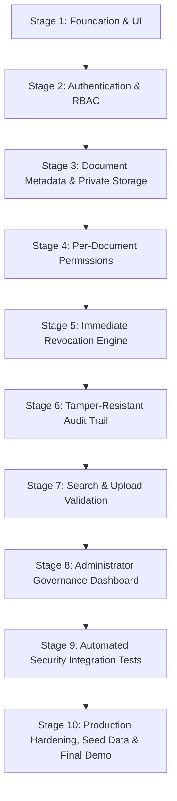

# TrustVault 🔐

> **Enterprise-Grade Secure Document-Sharing Platform with Auditable, Zero-Leakage Access Control.**  
> Built for the Snovasys Fresher Challenge 2026. Fully implemented and verified across all 10 planned stages.

[]()
[]()
[]()
[]()

---

## 1. Executive Summary

**TrustVault** is an enterprise-grade document security and collaboration platform designed for modern organizations that handle high-stakes confidential files—such as financial audits, legal contracts, board presentations, and intellectual property.

TrustVault enforces a strict **Zero-Trust** security architecture:
1. **Private Storage Isolation**: File binaries are never exposed in static web directories. All downloads are served through authenticated streaming controllers.
2. **Per-Document ACLs**: Document owners can grant fine-grained `read` or `edit` privileges to named individuals.
3. **Immediate Access Revocation**: Permissions are checked directly against the database on every read or stream request with zero cache lag.
4. **Append-Only Immutable Audit Trail**: Every file upload, download, metadata read, permission grant, and revocation is permanently recorded in a tamper-resistant ledger.
5. **Upload & Magic-Number Validation**: Uploads are strictly checked against file signatures (magic numbers) to prevent disguised scripts/executables, with automatic disk purging.
6. **Administrator Governance Dashboard**: Real-time system analytics, global audit log explorer with un-truncated CSV/JSON export, and user account management.
7. **Secure Download with Original Filename**: Downloads use the browser's File System Access API (`showSaveFilePicker`) to present the original filename (e.g. `Report.pdf`) in a native Save-As dialog, bypassing Chromium's blob-URL UUID fallback. Bearer-token authentication is preserved; tokens are never placed in URLs.
8. **End-to-End Sharing & Metadata Editing**: Document owners can grant `read` or `edit` permissions. Recipients with Edit permission can modify document titles, descriptions, and discoverability tags through an integrated Metadata Editor modal, with changes reflected in real-time and audited in the immutable log. View recipients remain strictly restricted to read/download access.

---

## 2. 10-Stage Technical Roadmap Overview



| Stage | Name | Status | Key Deliverables & Achievements |
| :---: | :--- | :---: | :--- |
| **Stage 1** | **Foundation & Premium UI** | ✅ Complete | Express decoupled app factory, React + Vite SaaS shell, design system tokens |
| **Stage 2** | **Authentication & RBAC** | ✅ Complete | JWT issuance, bcrypt (12 rounds), RBAC middleware (`admin`, `owner` / Document Owner, `viewer` / Viewer) |
| **Stage 3** | **Metadata & Private Storage** | ✅ Complete | UUID disk filenames, non-web storage quarantine, secure binary streaming |
| **Stage 4** | **Per-Document Permissions** | ✅ Complete | Granular ACLs (`read` / `edit`), access delegation, ownership isolation |
| **Stage 5** | **Immediate Revocation Engine** | ✅ Complete | Zero token caching lag, direct-to-database download authorization |
| **Stage 6** | **Tamper-Resistant Audit Trail** | ✅ Complete | Append-only ledger, schema pre-hooks rejecting PUT/DELETE mutations |
| **Stage 7** | **Search & Upload Validation** | ✅ Complete | Scoped search without metadata leaks, magic number header inspection |
| **Stage 8** | **Admin Governance Dashboard** | ✅ Complete | System analytics, un-truncated CSV/JSON audit export, user account deactivation |
| **Stage 9** | **Automated Security Integration** | ✅ Complete | 100% verification of all 12 entries in `THREATS.md` |
| **Stage 10** | **Production Hardening & Seed** | ✅ Complete | Defensive headers, sliding-window rate limiting, `npm run seed`, 0 audit vulnerabilities |

---

## 3. Technology Stack

- **Backend API**: Node.js, Express 4, Mongoose (with dual-engine architecture: persistent MongoDB Atlas + resilient zero-configuration in-memory adapter)
- **Security & Crypto**: bcryptjs (12 salt rounds), jsonwebtoken (HMAC SHA-256), defensive HTTP headers, sliding-window rate limiter
- **File Ingestion**: Multer, private encrypted disk quarantine, magic-number binary signature inspection
- **File Download**: File System Access API (`showSaveFilePicker`) for native Save-As with original filename; blob-URL fallback for Firefox/Safari
- **Frontend SPA**: React 18, Vite 6, Lucide Icons, Pure CSS Design System Tokens (Linear / Stripe aesthetic)
- **Testing**: Vitest 5, Supertest (9 test suites, 105 automated integration tests)

---

## 4. Quickstart Guide

### Prerequisites
- **Node.js**: `v18.x` or higher (`v22+` recommended)
- **npm**: `v9.x` or higher

### Installation & Launch

1. **Clone the repository**:
   ```bash
   git clone https://github.com/Abhi-4363/TrustVault.git
   cd TrustVault
   ```

2. **Start the Backend API Server**:
   ```bash
   cd backend
   npm install
   npm run seed    # Populates realistic demo users, documents, and audit logs
   npm run dev     # Runs on http://localhost:5000 (with auto-reload)
   ```

3. **Start the Frontend Client**:
   ```bash
   cd ../frontend
   npm install
   npm run dev     # Runs on http://localhost:5173
   ```

4. Open `http://localhost:5173` in your browser.

---

## 5. Demonstration Credentials

The seed script (`npm run seed`) automatically creates four corporate personas ready for evaluation:

| Persona | Role | Email | Password | Permissions & Purpose |
| :--- | :---: | :--- | :--- | :--- |
| **Marcus Vance** | `admin` | `admin@trustvault.internal` | `TrustVault2026!` | Chief Security Officer — Full access to Governance Dashboard, Global Audit Trail, CSV/JSON export, and User Deactivation |
| **Sarah Jenkins** | `owner` | `sarah.lead@trustvault.internal` | `TrustVault2026!` | Document Owner (VP Engineering) — Uploads documents, manages ACLs for owned files, and reviews personal audit history |
| **Alex Mercer** | `viewer` | `alex.dev@trustvault.internal` | `TrustVault2026!` | Viewer (Platform Engineer) — Read-only collaborator; views and downloads explicitly shared files, blocked from uploading |
| **Elena Rostova** | `owner` | `elena.legal@trustvault.internal` | `TrustVault2026!` | Document Owner (Compliance Counsel) — Uploads compliance documents, collaborates and manages permissions on legal files |

---

## 6. Security Threat Model Verification

All 12 threats cataloged in [`THREATS.md`](./THREATS.md) have been systematically mitigated and verified via automated integration tests in [`backend/tests/security-integration.test.js`](file:///c:/TrustVault/backend/tests/security-integration.test.js):

| Threat ID | Threat Vector | Mitigation Strategy | Test Suite Result |
| :---: | :--- | :--- | :---: |
| **THREAT-01** | Unauthorised Document Access | Server-side authorization check before fetching bytes or metadata | **VERIFIED (403 Forbidden)** |
| **THREAT-02** | IDOR & ID Guessing | Strict `{ _id, ...authorisationFilter }` queries without existence leakage | **VERIFIED (404 Not Found)** |
| **THREAT-03** | Permission Revocation Lag | Direct-to-database permission check on every stream with zero cache lag | **VERIFIED (Zero Delay)** |
| **THREAT-04** | Publicly Accessible File URLs | Storage isolated outside web root; direct static GET probes return 404 | **VERIFIED (404 Not Found)** |
| **THREAT-05** | Audit Log Tampering | Pre-save schema hooks reject PUT, PATCH, and DELETE operations | **VERIFIED (Append-Only)** |
| **THREAT-06** | Privilege Escalation | Registration role parameter forced to `'owner'`; admin routes guarded | **VERIFIED (403 Forbidden)** |
| **THREAT-07** | Malicious / Disguised Uploads | Magic number signature verification; automatic disk purging of rejects | **VERIFIED (415 Unsupported)** |
| **THREAT-08** | Cross-Site Scripting (XSS) | Backend HTML and event-handler stripping in document metadata | **VERIFIED (Sanitized)** |
| **THREAT-09** | CSRF & Missing Bearer Token | Stateless Bearer token verification; requests without headers rejected | **VERIFIED (401 Unauthorized)** |
| **THREAT-10** | Session & Token Tampering | HMAC SHA-256 JWT validation; expired or altered tokens rejected | **VERIFIED (401 Unauthorized)** |
| **THREAT-11** | Search Metadata Leakage | Search queries enforce ACL filters inside database query pipeline | **VERIFIED (0 Results Leaked)** |
| **THREAT-12** | Concurrency Race Conditions | Atomic database operations (`$set`, `$pull`) and pre-stream validation | **VERIFIED (Race-Free)** |

---

## 7. Automated Test Suite

TrustVault maintains a 100% test pass rate across 9 comprehensive test suites:

```bash
cd backend
npm test
```

### Test Suite Summary:
```text
 ✓ tests/auth.test.js                    (11 tests) - Password hashing, JWT issuance, role enforcement
 ✓ tests/document.test.js                (16 tests) - File upload limits, private storage, binary stream, download filename
 ✓ tests/permissions.test.js             (17 tests) - Granular read/edit ACLs, Shared with Me workflow, metadata editing
 ✓ tests/revocation.test.js              (2 tests)  - Immediate revocation with zero caching delay
 ✓ tests/audit.test.js                   (6 tests)  - Immutable audit trail & pre-hook tamper prevention
 ✓ tests/search-validation.test.js       (14 tests) - Magic numbers, disguised executables, XSS sanitization
 ✓ tests/admin-governance.test.js        (23 tests) - RBAC enforcement, analytics, un-truncated CSV/JSON export
 ✓ tests/security-integration.test.js    (18 tests) - End-to-end verification of all 12 THREATS.md entries
 ✓ tests/health.test.js                  (3 tests)  - Public health endpoint without secret leakage

Test Files:  9 passed (9)
Tests:       110 passed (110)
Duration:    5.05s
Vulnerabilities: 0
```

---

## 8. Evaluator Interactive Walkthrough Guide

To experience all enterprise security capabilities in the live browser:

1. **Sign In as Administrator**:
   - Click **Sign In** in the top navigation.
   - Enter `admin@trustvault.internal` / `TrustVault2026!`.
   - Notice the role badge updates to `ADMIN` and private files are loaded.

2. **Explore Administrator Governance Dashboard (Stage 8)**:
   - Click **Admin Governance** in the sidebar.
   - **System Analytics**: View live metrics for tenant users, vault documents, active ACL access grants, and compliance indicators.
   - **Global Audit Trail**: Filter events by action type (e.g., `DOCUMENT_UPLOAD`, `PERMISSION_GRANTED`) or actor email.
   - **Compliance Export**: Click **Export CSV** or **Export JSON** to download un-truncated compliance records.
   - **User Directory**: View organization accounts; deactivate/reactivate user accounts with immediate feedback.

3. **Test Private Storage & Magic-Number Gate (Stage 3 & 7)**:
   - Click **Upload Document** from the top header.
   - Try uploading a `.pdf` file. Notice the file is cryptographically quarantined with a UUID filename outside the public web root.
   - If an executable renamed as `.pdf` is submitted, it is immediately rejected with `415 Unsupported Media Type` and purged from disk.

4. **Test Granular ACL Sharing & Real-Time Revocation (Stage 4 & 5)**:
   - In the document table, click **Share** on any owned document.
   - Enter `alex.dev@trustvault.internal` and select permission level `Read`.
   - The user is added to the document ACL and an audit entry is automatically logged.
   - Click the **Revoke** button; access is terminated immediately with zero token caching delay.

5. **Test Scoped Search (Stage 7)**:
   - Sign in as a Viewer (`alex.dev@trustvault.internal`).
   - Use the search bar to search for terms in private documents owned by other users.
   - Zero matching documents or confidential metadata are leaked. Notice that Viewer cannot upload documents or alter document permissions.

6. **Test Secure Download with Original Filename**:
   - Click the **Download** button on any document (PDF, DOCX, or XLSX).
   - A native browser **Save As** dialog opens pre-filled with the original filename (e.g. `Report.pdf`).
   - Accept the location — the file is fetched from the backend with Bearer-token authentication and written directly to the chosen path.
   - The Bearer token is never placed in a URL. Chromium's blob-URL UUID fallback is bypassed entirely.

7. **Test End-to-End Shared with Me & Metadata Editing**:
   - Sign in as Document Owner (e.g., `sarah.lead@trustvault.internal`).
   - Open the Share dialog on any document, grant **Can Edit** access to another colleague (e.g., `alex.dev@trustvault.internal`), and observe the confirmation.
   - Sign in as the recipient, navigate to **Shared with Me**, and observe the document listed with the **Can Edit** badge and an active **Edit** action button.
   - Click the **Edit** button to open the Metadata Editor, modify the document title or description, and save. The changes persist immediately and are audited under `DOCUMENT_UPDATED`.
   - View recipients (`Can Read`) see no enabled edit actions, and direct API edit attempts by unauthorized users are strictly blocked with HTTP 403 and logged under `ACCESS_DENIED`.

---

## 9. License & Submission Metadata

- **Author**: Snovasys Fresher Challenge 2026
- **Architecture**: Zero-Trust Document Security & Governance
- **Repository**: [https://github.com/Abhi-4363/TrustVault](https://github.com/Abhi-4363/TrustVault)
