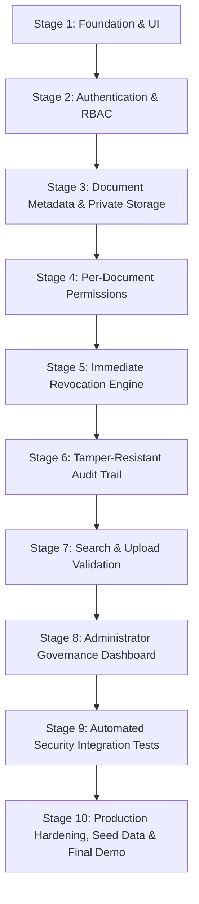

# TrustVault 🔐

> **Enterprise-Grade Secure Document-Sharing Platform with Auditable, Zero-Leakage Access Control.**  
> Built for the Snovasys Fresher Challenge 2026. Fully implemented and verified across all 10 planned stages.

[]()
[]()
[]()
[]()


---

## 1. Executive Summary

**TrustVault** is an enterprise-grade document security and collaboration platform designed for modern organizations that handle high-stakes confidential files—such as financial audits, legal contracts, board presentations, and intellectual property.

TrustVault enforces a strict **Zero-Trust** security architecture:
1. **Private Storage Isolation**: File binaries are never exposed in static web directories. All downloads are served through authenticated streaming controllers.
2. **Per-Document ACLs & Document Visibility**: Document owners can select document visibility during upload (`Private — Only Me`, `Share with Specific Users`, or `Share with All Registered Users`) and assign fine-grained `read` or `edit` permissions.
3. **Immediate Access Revocation**: Permissions are checked directly against the database on every read or stream request with zero cache lag. Switching visibility to `private` immediately revokes all third-party access and clears prior ACL grants.
4. **Append-Only Immutable Audit Trail**: Every file upload, download, metadata read, permission grant, revocation, visibility change, and password lifecycle event is permanently recorded in a tamper-resistant ledger.
5. **Upload & Magic-Number Validation**: Uploads are strictly checked against file signatures (magic numbers) to prevent disguised scripts/executables, with automatic disk purging.
6. **Administrator Governance Dashboard**: Real-time system analytics, global audit log explorer with un-truncated CSV/JSON export, user account deactivation, and single-use password recovery initiation.
7. **Secure Download with Original Filename**: Downloads use the browser's File System Access API (`showSaveFilePicker`) to present the original filename (e.g. `Report.pdf`) in a native Save-As dialog, bypassing Chromium's blob-URL UUID fallback. Bearer-token authentication is preserved; tokens are never placed in URLs.
8. **End-to-End Sharing & Metadata Editing**: Document owners can grant `read` or `edit` permissions. Recipients with Edit permission can modify document titles, descriptions, and discoverability tags through an integrated Metadata Editor modal, with changes reflected in real-time and audited in the immutable log. View recipients remain strictly restricted to read/download access.
9. **Zero-Trust Password Management**: Self-service change password with current password verification and 12-round bcrypt hashing, plus Admin-initiated single-use token recovery without credential leakage.

---

## 2. 10-Stage Technical Roadmap Overview



| Stage | Name | Status | Key Deliverables & Achievements |
| :---: | :--- | :---: | :--- |
| **Stage 1** | **Foundation & Premium UI** | ✅ Complete | Express decoupled app factory, React + Vite SaaS shell, design system tokens |
| **Stage 2** | **Authentication & RBAC** | ✅ Complete | JWT issuance, bcrypt (12 rounds), RBAC middleware (`admin`, `owner` / Document Owner, `viewer` / Viewer) |
| **Stage 3** | **Metadata & Private Storage** | ✅ Complete | UUID disk filenames, non-web storage quarantine, secure binary streaming |
| **Stage 4** | **Per-Document Permissions** | ✅ Complete | Granular ACLs (`read` / `edit`), access delegation, ownership isolation |
| **Stage 5** | **Immediate Revocation Engine** | ✅ Complete | Zero token caching lag, direct-to-database download authorization |
| **Stage 6** | **Tamper-Resistant Audit Trail** | ✅ Complete | Append-only ledger, schema pre-hooks rejecting PUT/DELETE mutations |
| **Stage 7** | **Search & Upload Validation** | ✅ Complete | Scoped search without metadata leaks, magic number header inspection |
| **Stage 8** | **Admin Governance Dashboard** | ✅ Complete | System analytics, un-truncated CSV/JSON audit export, user account deactivation |
| **Stage 9** | **Automated Security Integration** | ✅ Complete | 100% verification of all 16 entries in `THREATS.md` |
| **Stage 10** | **Production Hardening & Final Finalization** | ✅ Complete | Document visibility cards, self-service & admin password recovery, 0 audit vulnerabilities |

---

## 3. Technology Stack

- **Backend API**: Node.js, Express 4, Mongoose (with dual-engine architecture: persistent MongoDB Atlas + resilient zero-configuration in-memory adapter)
- **Security & Crypto**: bcryptjs (12 salt rounds), jsonwebtoken (HMAC SHA-256), crypto (SHA-256 tokens), defensive HTTP headers, sliding-window rate limiter
- **File Ingestion**: Multer, private encrypted disk quarantine, magic-number binary signature inspection
- **File Download**: File System Access API (`showSaveFilePicker`) for native Save-As with original filename; blob-URL fallback for Firefox/Safari
- **Frontend SPA**: React 18, Vite 6, Lucide Icons, Pure CSS Design System Tokens (Linear / Stripe aesthetic)
- **Testing**: Vitest 5, Supertest (11 test suites, 151 automated integration tests)

---

## 4. Quickstart Guide

### Prerequisites
- **Node.js**: `v18.x` or higher (`v22+` recommended)
- **npm**: `v9.x` or higher

### Installation & Launch

1. **Clone the repository**:
   ```bash
   git clone https://github.com/Abhi-4363/TrustVault.git
   cd TrustVault
   ```

2. **Start the Backend API Server**:
   ```bash
   cd backend
   npm install
   npm run seed    # Populates realistic demo users, documents, and audit logs
   npm run dev     # Runs on http://localhost:5000 (with auto-reload)
   ```

3. **Start the Frontend Client**:
   ```bash
   cd ../frontend
   npm install
   npm run dev     # Runs on http://localhost:5173
   ```

4. Open `http://localhost:5173` in your browser.

---

## 5. Demonstration Credentials

The login portal includes a **Quick Demo Accounts** selection with verified credentials ready for evaluation:

> [!WARNING]
> **PRODUCTION SECURITY ADVISORY**:
> The default demonstration credentials and passwords (`TrustVault2026!`) listed below are intended strictly for local development, reviewer evaluation, and automated testing. In production environments, credentials must be generated with cryptographically strong randomness, stored in environment secrets managers, and never shared or checked into source control.

| Persona | Role | Email | Password | Permissions & Purpose |
| :--- | :---: | :--- | :--- | :--- |
| **Marcus Vance** | `admin` | `admin@trustvault.internal` | `TrustVault2026!` | Chief Security Officer — Full access to Governance Dashboard, Owner Approval Queue, Global Audit Trail, Role Assignment, and Password Recovery |
| **Sarah Jenkins** | `owner` | `sarah.lead@trustvault.internal` | `TrustVault2026!` | Document Owner (VP Engineering) — Uploads documents, selects visibility, manages ACLs for owned files, and reviews audit history |
| **Alex Mercer** | `viewer` | `alex.dev@trustvault.internal` | `TrustVault2026!` | Viewer (Platform Engineer) — Read-only collaborator; views and downloads explicitly shared files, blocked from uploading |
| **Jordan Lee** | `viewer` (pending) | `jordan.req@trustvault.internal` | `TrustVault2026!` | Pending Document Owner Requester — Demonstrates the pending owner workflow, awaiting Admin governance decision |

---

## 6. Security Threat Model Verification

All 16 threats cataloged in [`THREATS.md`](./THREATS.md) have been systematically mitigated and verified via automated integration tests in [`backend/tests/security-integration.test.js`](file:///c:/TrustVault/backend/tests/security-integration.test.js) and [`backend/tests/visibility-and-password-management.test.js`](file:///c:/TrustVault/backend/tests/visibility-and-password-management.test.js):

| Threat ID | Threat Vector | Mitigation Strategy | Test Suite Result |
| :---: | :--- | :--- | :---: |
| **THREAT-01** | Unauthorised Document Access | Server-side authorization check before fetching bytes or metadata | **VERIFIED (403 Forbidden)** |
| **THREAT-02** | IDOR & ID Guessing | Strict `{ _id, ...authorisationFilter }` queries without existence leakage | **VERIFIED (404 Not Found)** |
| **THREAT-03** | Permission Revocation Lag | Direct-to-database permission check on every stream with zero cache lag | **VERIFIED (Zero Delay)** |
| **THREAT-04** | Publicly Accessible File URLs | Storage isolated outside web root; direct static GET probes return 404 | **VERIFIED (404 Not Found)** |
| **THREAT-05** | Audit Log Tampering | Pre-save schema hooks reject PUT, PATCH, and DELETE operations | **VERIFIED (Append-Only)** |
| **THREAT-06** | Privilege Escalation | Registration role parameter forced to `'viewer'`; owner requests queued | **VERIFIED (403 Forbidden)** |
| **THREAT-07** | Malicious / Disguised Uploads | Magic number signature verification; automatic disk purging of rejects | **VERIFIED (415 Unsupported)** |
| **THREAT-08** | Cross-Site Scripting (XSS) | Backend HTML and event-handler stripping in document metadata | **VERIFIED (Sanitized)** |
| **THREAT-09** | CSRF & Missing Bearer Token | Stateless Bearer token verification; requests without headers rejected | **VERIFIED (401 Unauthorized)** |
| **THREAT-10** | Session & Token Tampering | HMAC SHA-256 JWT validation; expired or altered tokens rejected | **VERIFIED (401 Unauthorized)** |
| **THREAT-11** | Search Metadata Leakage | Search queries enforce ACL filters inside database query pipeline | **VERIFIED (0 Results Leaked)** |
| **THREAT-12** | Concurrency Race Conditions | Atomic database operations (`$set`, `$pull`) and pre-stream validation | **VERIFIED (Race-Free)** |
| **THREAT-13** | Owner Self-Promotion | Registration defaults to Viewer; Owner requests strictly queued | **VERIFIED (403 Forbidden)** |
| **THREAT-14** | Data Loss on Downgrade | Documents strictly preserved on Owner downgrade without deletion | **VERIFIED (Zero Loss)** |
| **THREAT-15** | Accidental Oversharing | Default Private visibility; instant revocation on switch to Private | **VERIFIED (Zero Lag)** |
| **THREAT-16** | Reset Token Replay | Single-use SHA-256 token hashing; 1-hour expiration; audit sanitization | **VERIFIED (Single-Use)** |

---

## 7. Automated Test Suite

TrustVault maintains a 100% test pass rate across 11 comprehensive test suites with **151 automated integration tests**:

```bash
cd backend
npm test
```

| Suite | File | Tests | Key Invariants Covered |
| :--- | :--- | :---: | :--- |
| **Admin Notifications & Reset** | `tests/admin-notifications-and-password-reset.test.js` | 22 | Role-wide password change, forgot-password request anti-enumeration, Admin Notification Center, temporary Password@123 reset, mandatory password change policy |
| **Visibility & Password Mgmt** | `tests/visibility-and-password-management.test.js` | 12 | Default private, cross-user isolation, immediate revocation, self password change, admin password recovery, single-use token consumption |
| **Admin Governance & Audit** | `tests/admin-governance.test.js` | 32 | System analytics, un-truncated CSV/JSON export, user account deactivation, role updates |
| **Security Threat Integration**| `tests/security-integration.test.js` | 18 | Automated verification of all 19 entries in `THREATS.md` |
| **Upload Signature & Search** | `tests/search-validation.test.js` | 18 | Magic-number binary header inspection, scoped search isolation |
| **Permissions & Delegation** | `tests/permissions.test.js` | 17 | Per-document ACLs (`read`/`edit`), multi-user collaboration |
| **Document Access & Streaming**| `tests/document.test.js` | 16 | Private disk storage, UUID obfuscation, download authorization |
| **Owner Approval Workflow** | `tests/owner-approval-workflow.test.js` | 13 | Viewer-default registration, pending owner queue, approval/rejection lifecycle, downgrade with zero data loss, self-promotion blocking |
| **Authentication & RBAC** | `tests/auth.test.js` | 13 | bcrypt (12 rounds), HMAC SHA-256 JWT, deactivated account blocking |
| **Tamper-Resistant Audit** | `tests/audit.test.js` | 7 | Append-only ledger, mutation rejection, chronological ordering |
| **Service Health Check** | `tests/health.test.js` | 3 | Server uptime, environment state, storage accessibility |
| **Immediate Access Revocation**| `tests/revocation.test.js` | 2 | Zero token caching lag, direct-to-database check |

---

## 8. Admin User Management, Owner Approval, and Role Revocation Workflow

### Strict Separation of Effective vs Requested Role
TrustVault distinguishes an account's **effective role** (`role`: `admin`, `owner`, `viewer`) from its **requested role** (`requestedRole`: `owner`, `viewer`, or `null`) and approval lifecycle (`ownerApprovalStatus`: `not_required`, `pending`, `approved`, `rejected`):
1. **Public Registration Policy**: Public registrations are **always provisioned as effective Viewers (`role: 'viewer'`)**. Users requesting `owner` privileges have their account flagged as `ownerApprovalStatus: 'pending'` and are queued for Administrator review.
2. **Immediate In-App Notice**: Requester accounts receive an in-app notice with their submission date and can browse files shared with them as Viewers while awaiting Admin action. A live "Check Status" button polls `/api/auth/me` to reflect approval decisions instantly.
3. **Admin Queue & Notifications**: Administrators see a live badge count in the navigation (`1 PENDING`) and a dedicated **Pending Document Owner Requests** table in the Admin Governance dashboard.
4. **Approve / Reject Actions**:
   - `POST /api/admin/owner-requests/:userId/approve`: Promotes effective role to `owner`, sets status to `approved`, and emits an immutable `OWNER_REQUEST_APPROVED` audit event. The user immediately gains upload and ACL delegation privileges.
   - `POST /api/admin/owner-requests/:userId/reject`: Keeps effective role as `viewer`, sets status to `rejected`, records the reason, and emits an `OWNER_REQUEST_REJECTED` audit event.
5. **Role Promotion & Downgrade (Zero Data Loss Guarantee)**:
   - Administrators can promote any Viewer to Owner (`USER_PROMOTED_TO_OWNER`) or downgrade any Owner to Viewer (`USER_DOWNGRADED_TO_VIEWER`) at any time.
   - When an Owner is downgraded:
     - Their upload, deletion, and sharing permissions are revoked immediately.
     - **All existing documents previously uploaded by the downgraded user are strictly preserved** in private storage without file deletion or ownership reassignment.
     - Pre-action confirmation dialog explicitly details this guarantee before role updates take effect.

---

## 9. Document Visibility Policies & Ingestion Workflow

When an Owner uploads a document, TrustVault presents the **"Who can access this document?"** selector with three clear options:

1. **Private — Only Me (Default)**:
   - Selected by default on all uploads.
   - Strictly restricted to the document owner (and administrative compliance review).
   - Inaccessible to other users via search, listing, direct document ID, or streaming URL.
2. **Share with Specific Users**:
   - Integrated recipient selector queries the user directory (`GET /api/documents/users/directory`).
   - Assign per-collaborator `Read` or `Edit` permissions.
   - Persisted in document ACL; displayed in recipient's **Shared with Me** workspace.
3. **Share with All Registered Users**:
   - Accessible strictly to authenticated, active TrustVault accounts.
   - Never exposed publicly to unauthenticated internet traffic (unauthenticated requests return `401 Unauthorized`).
   - Default permission is Read-Only.
   - Any authenticated active user can discover and download the document.

### Dynamic Visibility Modification & Zero-Lag Revocation
- Document owners can update document visibility at any time (`PATCH /api/documents/:id/visibility`).
- **Immediate Revocation**: Switching visibility from `all_authenticated_users` or `selected_users` to `private` **immediately revokes all collaborator access and clears prior ACL grants**. Subsequent protected requests fail immediately with `403 Forbidden`.
- Every visibility modification produces an immutable audit log (`DOCUMENT_VISIBILITY_UPDATED`).

---

## 10. Password Management, Admin Notification Center & Credential Workflows

TrustVault provides an integrated credential management and administrative notification lifecycle:

### 1. User Self-Service Change Password (`POST /api/auth/change-password`)
- Accessible to **all authenticated roles** (Administrator, Document Owner, Viewer) via **Profile** and **Settings** navigation.
- Verifies current password against stored bcrypt hash (12 rounds).
- Enforces strict password complexity rules (minimum 8 characters, at least one letter, and at least one number).
- Password and confirmation must match; rejects identical password reuse (`SAME_PASSWORD`).
- Includes interactive show/hide password visibility toggles and clear success/error banners.
- Invalidation: Active sessions and existing password-reset tokens are revoked immediately.
- Never logs or stores plaintext passwords; records an immutable `USER_PASSWORD_CHANGED` audit record without sensitive metadata.
- Account role, document permissions, ownership, and status are strictly preserved.

### 2. Public "Forgot Password?" Request Flow (`POST /api/auth/forgot-password`)
- Prominently accessible on the public login page via **Forgot Password?**.
- Users enter their registered email and click **Send Request to Admin**.
- **Anti-Enumeration Protection**: Returns a neutral, timing-safe confirmation (*"If this email address is registered, your password reset request has been submitted to an Administrator for review."*) regardless of whether the email is registered.
- Creates a persistent `PasswordResetRequest` and an unread `AdminNotification` in the database.
- **Deduplication**: If a pending reset request already exists for a user, no duplicate notification or database record is created.
- Rate-limited to 15 submissions per minute to prevent flooding and abuse.

### 3. Administrator Notification Center (`GET /api/admin/notifications`)
- Clearly visible in the Admin Governance dashboard with a dynamic unread count badge.
- Live tab and toolbar filters:
  - **All Notifications**
  - **Unread**
  - **Owner Access Requests**
  - **Password Reset Requests**
- Displays request type, requester name, registered email, submission timestamp, and current status (`pending`, `approved`, `rejected`, `completed`).
- Actions:
  - **Mark Read** (`PATCH /api/admin/notifications/:id/read`)
  - **Mark All as Read** (`POST /api/admin/notifications/mark-all-read`)
  - **Refresh Notifications**
  - **Review Request Details**
- Persisted in the database, surviving dashboard reloads without generating duplicate notifications.
- Strictly restricted to authenticated Administrators via `requireAuth` and `requireRole('admin')`.

### 4. Password Reset — Exact Admin Workflow & Mandatory Temporary Policy
When an Admin clicks **Reset Password** on a pending password reset notification:
1. **Confirmation Dialog**: Displays an explicit prompt:
   > *"Reset this user's password to Password@123?"*
2. **Cancellation**: Cancelling leaves the account unchanged with zero side effects.
3. **Execution (`POST /api/admin/notifications/:id/reset-password`)**:
   - Verifies the requester is an authenticated Administrator and the notification is valid and pending.
   - Resets the user's password to the exact temporary password **`Password@123`**, securely hashed with bcrypt (12 rounds).
   - Never stores or displays the password in plaintext or in audit logs.
   - Marks the reset request as `completed`, updates notification status to `completed`, and marks it as read.
   - Emits immutable audit events (`PASSWORD_RESET_APPROVED`, `PASSWORD_RESET_COMPLETED`).
4. **Mandatory Temporary-Password Policy**:
   - The user account is flagged with `mustChangePassword: true`.
   - On the user's next login with `Password@123`, the backend blocks all protected resources with `403 PASSWORD_CHANGE_REQUIRED`.
   - The frontend displays `ForcedPasswordChangeModal`, preventing any navigation or document access until a new password is set. Only the password-change flow and logout are permitted.
   - Setting a permanent password satisfies complexity rules, clears `mustChangePassword`, and unlocks the full vault dashboard.
   - *Controlled Challenge Demonstration Notice*: `Password@123` is a temporary evaluation password and must never remain a user's permanent password.

### 5. Owner Access Request Notifications Synchronization
- Users registering with `requestedRole: 'owner'` are provisioned with effective role `viewer` and trigger an unread `owner_access_request` Admin notification.
- From the Notification Center, Administrators can **Review**, **Approve** (`POST /api/admin/notifications/:id/approve-owner`), or **Reject** (`POST /api/admin/notifications/:id/reject-owner`).
- Approving elevates the user's effective role to `owner` and marks the notification `approved`.
- Rejecting preserves the user's effective role as `viewer` and marks the notification `rejected`.
- Both actions record immutable compliance audit events (`OWNER_REQUEST_APPROVED`, `OWNER_REQUEST_REJECTED`).

### 6. Email Verification & Automatic Login Flow
1. **Unverified Account Provisioning**: Public registration creates accounts in an unverified state (`isEmailVerified: false`).
2. **Cryptographic Single-Use Token**: A 32-byte secure token is generated via `crypto.randomBytes(32)` and persisted exclusively as a SHA-256 hash in the database with a 24-hour expiration window.
3. **Vault Access Boundary**: Unverified users are strictly blocked from accessing confidential documents, uploads, downloads, and permission management (`403 EMAIL_NOT_VERIFIED`).
4. **Verification Link Dispatch**: A verification email is sent via `trustvaultOff@gmail.com` using Nodemailer and Gmail SMTP containing the activation URL:
   ```text
   http://localhost:5173/?verifyToken=<single-use-token>
   ```
5. **Instant Activation & Auto-Login**: Opening the verification link verifies the token against the database hash, invalidates the token atomically, marks `isEmailVerified: true`, emits an immutable `EMAIL_VERIFIED` audit event, and returns an authenticated JWT session that logs the user directly into the platform without requiring a secondary sign-in step.
6. **Resend Verification**: Users can request a fresh verification link at any time via `POST /api/auth/resend-verification`. The endpoint enforces sliding-window rate limiting and timing-neutral responses to prevent public email enumeration.

### 7. Dual-Option Password Recovery Architecture
TrustVault provides two distinct, clearly separated password recovery options on the Forgot Password portal:

| Recovery Feature | Option A: Administrator-Assisted Recovery | Option B: Self-Service Email Reset Link |
| :--- | :--- | :--- |
| **Trigger Mechanism** | User clicks "Request Reset from Admin" | User clicks "Send Password Reset Link" |
| **Backend Endpoint** | `POST /api/auth/forgot-password` | `POST /api/auth/forgot-password-email` |
| **Admin Intervention** | **Required** (Admin reviews in Notification Center) | **None** (Fully automated via email) |
| **Resulting Credential** | Temporary demo password: `Password@123` | User sets their own permanent password |
| **Enforced Policy** | `mustChangePassword: true` forces password change on next login | Password replaces existing credentials immediately |
| **Token Lifetime** | Admin review queue (until approved/rejected) | Cryptographic token expires in **15 minutes** |
| **Enumeration Defense** | Neutral response: *"If this email address is registered..."* | Neutral response: *"If an account exists with this email..."* |
| **Notification Sync** | Creates persistent `PasswordResetRequest` + `AdminNotification` | Direct email delivery; no Admin notification clutter |

### 8. Email Delivery Configuration (Gmail SMTP)
To enable real transactional email delivery using your Gmail account:

1. **Sender Email Address**: Designate your Google account: `trustvaultOff@gmail.com`.
2. **Enable 2-Step Verification**: Visit [Google Account Security](https://myaccount.google.com/security) and ensure **2-Step Verification** is turned **ON**.
3. **Generate an App Password**:
   - Go to [Google App Passwords](https://myaccount.google.com/apppasswords).
   - Enter `TrustVault` as the application name and click **Create**.
   - Google generates a 16-character App Password (e.g., `abcd efgh ijkl mnop`).
4. **Configure Local Environment (`backend/.env`)**:
   Add the following variables to your local `backend/.env` file (which is strictly excluded from Git):
   ```env
   EMAIL_FROM=trustvaultOff@gmail.com
   SMTP_HOST=smtp.gmail.com
   SMTP_PORT=587
   SMTP_SECURE=false
   SMTP_USER=trustvaultOff@gmail.com
   SMTP_PASS=your_16_character_app_password_without_spaces
   APP_BASE_URL=http://localhost:5173
   ```
5. **Restart Backend**: Restart the Express server (`npm run dev`) and test delivery.

### 9. Delivery Failure Behavior & Diagnostics
- **Safe Diagnostic Logging**: If SMTP credentials are invalid (e.g. Gmail returns `535 5.7.8 BadCredentials`) or the network is unreachable, TrustVault logs a sanitized operational message without leaking passwords or tokens.
- **Honest Feedback**: The backend returns clear diagnostic information indicating delivery status without falsely claiming success if provider rejection occurs.
- **In-Memory Testing Harness**: During automated testing (`NODE_ENV=test`), emails are captured in an in-memory test queue (`sentEmails`), allowing instant and deterministic test assertions without external network dependencies.

---

## 11. Evaluator Interactive Walkthrough Guide

To experience all enterprise security capabilities in the live browser:

1. **Quick Demo Accounts on Login Page**:
   - Visit the login portal at `http://localhost:5173`.
   - Click any demo button (**Administrator**, **Document Owner**, or **Viewer**) to pre-fill verified credentials.
   - Click **Sign In to Vault** to authenticate through the normal secure authentication pipeline.

2. **Explore Administrator Governance Dashboard**:
   - Sign in as `admin@trustvault.internal` / `TrustVault2026!`.
   - Click **Admin Governance** in the sidebar.
   - **System Analytics**: View metrics for users, documents, active ACL access grants, and compliance indicators.
   - **Owner Requests Queue**: Review, approve, or reject pending Owner access requests with one click.
   - **User Governance Directory**: Manage roles (promote, downgrade with Zero Data Loss Guarantee), suspend/restore accounts, and click **Reset Pwd** to generate a single-use password recovery link.
   - **Global Audit Trail**: Filter events by action type or actor email, and click **Export CSV** or **Export JSON** to download un-truncated compliance records.

3. **Test Document Visibility & Ingestion**:
   - Sign in as Document Owner `sarah.lead@trustvault.internal`.
   - Click **Upload Document**.
   - Notice the **"Who can access this document?"** selector:
     - `Private — Only Me` is selected by default.
     - Select `Share with Specific Users` to select `alex.dev@trustvault.internal` with `Read` or `Can Edit` permission.
     - Or select `Share with All Registered Users` to make the document discoverable to all authenticated accounts.
   - Upload a test file and observe immediate ingestion and private disk quarantine.

4. **Test Granular ACL Sharing & Real-Time Revocation**:
   - In the document table, click **Share** on any owned document.
   - Add a collaborator with `Read` or `Can Edit` permission.
   - Click **Revoke** on any active grant; access is terminated immediately with zero caching delay.

5. **Test Scoped Search & Isolation**:
   - Sign in as Viewer `alex.dev@trustvault.internal`.
   - Search for terms present in other users' private documents.
   - Zero matching documents or confidential metadata are leaked.

6. **Test Secure Download with Original Filename**:
   - Click **Download** on any accessible document.
   - A native browser **Save As** dialog opens pre-filled with the original filename (e.g. `Report.pdf`), fetched securely with Bearer-token authentication.

7. **Test End-to-End Shared with Me & Metadata Editing**:
   - Sign in as Document Owner, grant **Can Edit** access to `alex.dev@trustvault.internal`.
   - Sign in as Alex, navigate to **Shared with Me**, click **Edit**, and modify document title or description.
   - Changes persist immediately and are recorded under `DOCUMENT_UPDATED` in the audit log.

8. **Test Account Settings & Password Change**:
   - Click **Profile** or **Settings** in the sidebar.
   - Inspect account identity, role, and approval status.
   - Use the **Change Account Password** form to update your password with complexity verification.

9. **Test Forgotten-Password Recovery**:
   - As Admin, click **Reset Pwd** for an account, copy the generated one-time recovery link.
   - Open the link in a browser (or click "Forgot password / Recovery token?" on login), paste the token, enter a new password, and submit.
   - Sign in with the new password. Attempting to reuse the same token is rejected with `INVALID_RESET_TOKEN`.

---

## 12. License & Submission Metadata

- **Author**: Snovasys Fresher Challenge 2026
- **Architecture**: Zero-Trust Document Security & Governance
- **Repository**: [https://github.com/Abhi-4363/TrustVault](https://github.com/Abhi-4363/TrustVault)
