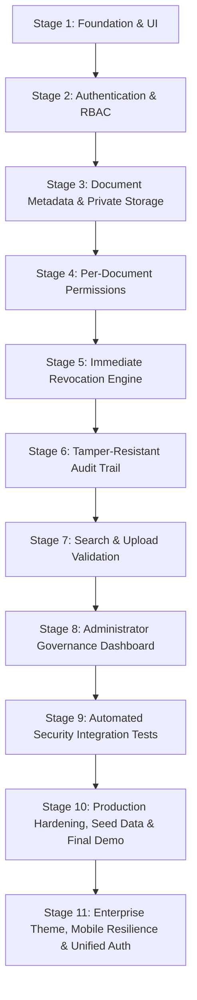

# TrustVault — Staged Technical Development Plan

> **Project Goal**: Build an enterprise-grade secure document-sharing platform with auditable, zero-leakage access control.  
> **Development Methodology**: Incremental staged delivery with strict quality gates, automated testing, and security verification at every step.

---

## Roadmap Overview

---

## Stage 1: Project Foundation and Premium UI
- **Primary Goal**: Establish repository hygiene, initial security baselines, documentation, modular backend structure with health check, and a modern, accessible React dashboard.
- **Deliverables**:
  1. Repository structure, `.gitignore`, `.env.example`, `README.md`, `THREATS.md`, `PROMPTS.md`.
  2. Express backend setup with decoupled app factory, `/api/health` endpoint, error handling, and 404 middleware.
  3. React + Vite frontend application with CSS variable design system, responsive AppShell, modern dashboard UI, and accessible navigation.
  4. Fictional demonstration dataset with explicit non-persisted disclaimers.
- **Completion Checks**:
  - [ ] Frontend builds successfully (`npm run build`) without errors or warnings.
  - [ ] Backend starts and responds with `200 OK` on `GET /api/health` without exposing secrets.
  - [ ] Page renders smoothly on desktop and mobile viewports with WCAG-compliant contrast.
  - [ ] All interactive buttons either perform local UI actions or open transparent Stage 1 limitation notices.

---

## Stage 2: Authentication and Role Model
- **Primary Goal**: Implement secure identity management, user registration, login, and tenant role assignment (e.g., Administrator, Manager, Member).
- **Deliverables**:
  1. MongoDB User model with bcrypt password hashing (minimum 12 salt rounds).
  2. Endpoints: `POST /api/auth/register`, `POST /api/auth/login`, `GET /api/auth/me`.
  3. JSON Web Token (JWT) issuance with short expiration and secure header parsing.
  4. Role-Based Access Control (RBAC) middleware (`requireAuth`, `requireRole`).
  5. Frontend authentication context, protected route wrappers, and login/register views.
- **Completion Checks**:
  - [ ] Unit tests verify passwords cannot be stored or returned in plaintext.
  - [ ] Expired or malformed JWTs receive `401 Unauthorized`.
  - [ ] Unauthenticated requests to protected routes fail with appropriate HTTP error codes.

---

## Stage 3: Document Metadata and Private Storage
- **Primary Goal**: Ingest documents securely and store binary data outside public web directories.
- **Deliverables**:
  1. MongoDB Document model (title, description, file size, MIME type, storage path, owner ID, tags, timestamps).
  2. Private file storage service (local encrypted disk storage isolated from `public/` web roots).
  3. Multi-part upload handler (Multer) with strict size limits (e.g., 25MB) and filename hashing.
  4. Secure document streaming endpoint `GET /api/documents/:id/download` with forced attachment headers.
- **Completion Checks**:
  - [ ] Static HTTP requests to raw storage directories receive `404 Not Found`.
  - [ ] Download requests verify authorization before opening file read stream.
  - [ ] Uploaded files are renamed using cryptographic UUIDs to prevent directory traversal.

---

## Stage 4: Per-Document Read and Edit Permissions
- **Primary Goal**: Enable document owners and admins to grant fine-grained permissions to named users.
- **Deliverables**:
  1. Granular Access Control List (ACL) subdocument schema: `{ userId, permissionLevel: 'read' | 'edit', grantedBy, grantedAt }`.
  2. Permission management endpoints: `POST /api/documents/:id/permissions`, `DELETE /api/documents/:id/permissions/:userId`.
  3. Server-side permission evaluation middleware (`canReadDocument`, `canEditDocument`).
  4. Frontend permission sharing dialog with user selection, permission toggles, and live feedback.
- **Completion Checks**:
  - [ ] User with 'read' permission cannot edit or delete document metadata.
  - [ ] User without permission receives `403 Forbidden` on both metadata and download requests.
  - [ ] Document list query strictly filters out documents the requesting user has no right to view.

---

## Stage 5: Immediate Revocation Engine
- **Primary Goal**: Ensure that when access is revoked, unauthorized access stops immediately without delay or cached permission leakage.
- **Deliverables**:
  1. Revocation handler removing user from document ACL and invalidating any active download tokens.
  2. Direct-to-database authorization checks prior to streaming document bytes (zero client-side caching of authorization).
  3. Immediate feedback in the frontend UI updating shared lists dynamically.
- **Completion Checks**:
  - [ ] Integration test: User A opens download stream, access is revoked by Owner, subsequent download request immediately returns `403`.
  - [ ] Revoked user can no longer view document metadata in search or list endpoints.

---

## Stage 6: Audit Trail and Integrity Protection
- **Primary Goal**: Maintain an immutable, tamper-resistant log of all critical document activities.
- **Deliverables**:
  1. AuditLog MongoDB collection (timestamp, actorId, action, targetDocumentId, ipAddress, userAgent, metadata).
  2. Central audit logger recording: `DOCUMENT_UPLOAD`, `DOCUMENT_READ`, `DOCUMENT_DOWNLOAD`, `PERMISSION_GRANTED`, `PERMISSION_REVOKED`, `DOCUMENT_DELETED`.
  3. Pre-save hooks disallowing updates or deletions to audit records (append-only enforcement).
  4. Audit log query endpoint `GET /api/documents/:id/audit` accessible only to owners and admins.
- **Completion Checks**:
  - [ ] Tests verify that `PUT`, `PATCH`, and `DELETE` queries on audit collection are rejected.
  - [ ] Every document access generates an audit record with timestamp and actor ID.

---

## Stage 7: Search, Metadata Indexing and Upload Validation
- **Primary Goal**: Add search capabilities while strictly preventing metadata leaks, alongside robust upload payload validation.
- **Deliverables**:
  1. Full-text search endpoint `GET /api/documents/search?q=...` scoped strictly to documents the user has permission to read.
  2. File signature / magic number validation (disallowing executables renamed with `.pdf` extension).
  3. Input sanitisation and schema validation using Joi or Zod to prevent XSS payloads in titles and notes.
- **Completion Checks**:
  - [x] Searching a confidential term present only in User A's private doc returns 0 results for User B.
  - [x] Uploading a malicious shell script disguised as `.png` is rejected with `415 Unsupported Media Type`.

---

## Stage 8: Administrator Governance Dashboard
- **Primary Goal**: Provide administrators with comprehensive visibility into organizational data security, permissions, and compliance.
- **Deliverables**:
  1. Admin analytics endpoints reporting system totals, permission distribution, and high-frequency access patterns.
  2. Global audit log viewer with filtering by actor, action type, date range, and document.
  3. User management console to deactivate accounts or view organization-wide permissions.
  4. Frontend Admin dashboard page with tabular data views and export capabilities (CSV/JSON audit export).
- **Completion Checks**:
  - [x] Non-admin users attempting to access `/api/admin/*` receive `403 Forbidden`.
  - [x] Audit logs export accurately reflects historical event data without data truncation.

---

## Stage 9: Automated Security Integration Tests
- **Primary Goal**: Implement an end-to-end automated security test suite validating all entries in `THREATS.md`.
- **Deliverables**:
  1. Vitest / Supertest suite covering IDOR prevention, permission boundaries, and injection vectors.
  2. Automated concurrency tests verifying rapid revocation handling.
  3. Security regression test runner integrated into project test script (`npm test`).
- **Completion Checks**:
  - [x] 100% of planned security tests in `THREATS.md` pass consistently.
  - [x] Zero unhandled errors or unescaped outputs detected during automated fuzzing.

---

## Stage 10: Production Hardening, Seed Data, Final Demo & Documentation
- **Primary Goal**: Prepare the application for deployment, final evaluation, and interactive demonstration.
- **Deliverables**:
  1. Realistic database seed script (`npm run seed`) populating demo organizations, users, documents, and audit logs.
  2. Environment hardening (Helmet security headers, rate limiting middleware, CORS lockdown).
  3. Production build optimization and deployment documentation.
  4. Step-by-step evaluator walkthrough script and video presentation guide.
- **Completion Checks**:
  - [x] Seed script executes idempotently and populates clean test data.
  - [x] Security audit (`npm audit`) shows 0 critical or high vulnerabilities.
  - [x] Final documentation completely reflects the verified implementation.

---

## Stage 11: Enterprise Appearance, Mobile Resilience & Unified Authentication Experience
- **Primary Goal**: Deliver a state-of-the-art UI/UX transformation with accessible enterprise themes, mobile gesture resilience, and strictly isolated authentication forms with zero state leakage.
- **Deliverables**:
  1. Top-Right Enterprise Theme Selector: Dark, Light, and System High-Contrast modes with persistent local storage, accessible popover menus, and dynamic CSS token switching.
  2. Mobile Document Ingestion Resilience: Transparent full-surface touch dropzones, binary MIME extension deduction for camera/gallery uploads (preventing 415 rejections), and 60-second retention on download blob URLs to eliminate truncated downloads on mobile browsers.
  3. Distinct Authentication Forms & State Synchronization: Direct-access URL search parameters (`?mode=register` / `?mode=login`), deep synchronization between props and internal modal state on mode changes, stale input and error notification clearing, and full browser navigation history handling.
- **Completion Checks**:
  - [x] Sign In and Create Account screens consistently render their respective forms with zero stale inputs or state leakage.
  - [x] Direct navigation via `?mode=register` opens the Create Account form directly without modal race conditions.
  - [x] Document upload succeeds smoothly on both desktop drag-and-drop and mobile touch environments.
  - [x] All 277 automated tests in the test suite pass (100% pass rate).
